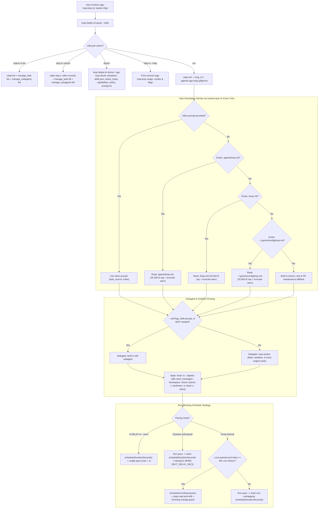

# `agy-loop` Technical Architecture

`agy-loop` implements a pure, Marketplace-compatible non-blocking `/agy-loop:loop` scheduler for **Google Antigravity Desktop** and **Antigravity CLI (`agy`)**. Rather than blocking an interactive turn with shell `sleep` or running noisy polling commands inside the primary conversation window, `agy-loop` splits scheduling, deterministic argument/state resolution, and single-pass task execution across crisp capability boundaries — never writing loose files to `~/.gemini/` outside the plugin bundle, while storing sandbox-safe per-loop state under `<workspace>/.agents/.agy-loop/` (automatically `.gitignore`d).

---

## 1. Repository Layout & Component Overview

```text
agy-loop/
├── plugin.json                              # Strict Antigravity v1 plugin manifest (additionalProperties: false)
├── hooks.json                               # SessionStart shadow & skills.json filter detector (0 tokens when clean)
├── package.json                             # Zero-dependency npm CLI bridge manifest (Node >= 18 ESM)
├── bin/
│   └── agy-loop.mjs                         # npm <-> `agy plugin` installer, shadow cleaner & upgraded doctor CLI
├── agents/
│   └── loop-worker.md                       # Isolated single-pass subagent (flash, sandbox, 6 cross-engine tools)
├── skills/
│   └── loop/
│       ├── SKILL.md                         # Session orchestrator skill (/agy-loop:loop, < 18 KB target / < 24 KB cap)
│       ├── scripts/
│       │   └── loop-helper.sh               # Pure POSIX sh parser, state-* store, loop.md resolver, hook & doctor (0755)
│       └── references/
│           └── examples-and-loop-md.md      # Progressive-disclosure recipes, templates & TUI controls
├── assets/
│   └── logo.svg                             # 128x128 square Marketplace icon
├── install.sh                               # Pure POSIX one-line & in-place (--clean-shadow) installer (UTC backups)
├── uninstall.sh                             # Pure POSIX clean uninstaller
└── tests/
    └── plugin.test.mjs                      # Isolated HOME unit, contract & strict-validator test suite
```

### Component Overview & Separation of Responsibilities

1. **Layer 1: Session Orchestrator (`skills/loop/SKILL.md`)**
   - Activated in the primary session when the user runs `/agy-loop:loop` (or clicks one of the 3 `suggestedPrompts` chips in Antigravity Desktop, or invokes a standalone `/loop` copy if deployed manually).
   - Owns **control flow only**: normalizing arguments and persisting `loop_id` state via `loop-helper.sh`, dispatching asynchronous subagents (`invoke_subagent` or `send_message`), validating the 4-line worker footer (enforcing `[10, 86400]` dynamic delay clamping and the 3-consecutive-error circuit breaker), printing a single `[Loop <loop_id> #N/Max]` summary line, scheduling the next wake-up via `schedule`, and cancelling finished schedules via `manage_task`.
   - Keeps its Markdown body strictly `< 18,000` bytes (well below Antigravity's `24,000`-byte `SKILL.md` truncation ceiling) by offloading extended templates and TUI guides to `skills/loop/references/examples-and-loop-md.md`.
2. **Layer 2: Isolated Iteration Worker (`agents/loop-worker.md` & `self`)**
   - Executes inside a clean subagent context window (`subagent: true`, `mainAgent: false`, `model: flash`, `commandExecutionPolicy: sandbox`).
   - Pins the **6-tool cross-engine intersection** (`view_file`, `write_to_file`, `replace_file_content`, `run_command`, `manage_task`, `search_web`) compatible with both **Antigravity Desktop (Cortex)** and **Antigravity CLI (`oneharness`)**.
   - Enforces **Single-Pass Discipline**: runs exactly one check, build, test, or fix+verify pass per wake-up, distinguishes `agy v1.5.5+` inherited dirty files in `Workspace: branch` worktrees, fails fast with `LOOP_STATUS: BLOCKED` on repeated permission/sandbox denials, and returns a structured 4-line plain-text footer.
   - Automatically delegates to the built-in full-capability **`self`** subagent instead of `loop-worker` whenever `--self` is passed, when the inline prompt starts with `/` (invoking a nested slash skill such as `/code-review`), or when MCP/browser tools are required.
3. **Deterministic POSIX Control Plane (`skills/loop/scripts/loop-helper.sh`)**
   - Pure `#!/bin/sh` (`set -eu`, `0755`, zero Node/Python runtime dependencies) invoked by the orchestrator and `SessionStart` hook.
   - Provides hardened argument parsing (unconditional multi-token lifecycle dispatch, prefix `every` + compound durations like `1h30m`, fractional rejection, two-tier unknown `--flag` validation), sandbox-safe externalized state (`state-init`, `state-read`, `state-update`, `state-list`, `state-stop`), `loop.md` precedence lookup (`25,000`-byte UTF-8-safe cap), POSIX ERE `skills.json` inspection, `session-start`, and `doctor [--clean-shadow]`.
4. **Zero-Overhead `SessionStart` Guard (`hooks.json`)**
   - Root `hooks.json` registers a `SessionStart` command hook invoking `sh ./skills/loop/scripts/loop-helper.sh session-start` (pure POSIX `sh`, zero Node.js required).
   - Strictly `protojson`-compliant for `agy v1.5.13+` (never echoing stdin fields such as `artifactDirectoryPath`): outputs `{}` in `<5ms` at **`0` tokens** when clean, and injects an `injectSteps` alert only when Tier 3 shadow files or `skills.json` `include_only`/`exclude` filters block `/agy-loop:loop`.
5. **Dual-Habitat Distribution Shell (`plugin.json` + `bin/agy-loop.mjs` + `install.sh`)**
   - Packages the repository root simultaneously as a native Antigravity v1 plugin (`agy plugin install https://github.com/maxlee/agy-loop`) and a zero-dependency npm CLI bridge (`npx agy-loop`) with unified UTC backup timestamps (`.agy-loop-backup-YYYYMMDD-HHMMSSZ`), `spawnSync` timeout protection (`15s`/`30s`, `AGY_LOOP_AGY_TIMEOUT_MS`), and an upgraded `doctor` suite (`agy v1.5.13` capability matrix, enterprise `admin_settings.json` / `settings.json` / `hooks.json` audit, `SessionStart` `protojson` `hookSelfTest`, `agentToolsCheck`, and `activeLoops`).

---

## 2. Three-Turn Reactive Non-Blocking Loop Lifecycle

In Antigravity, both `invoke_subagent` and `schedule` are **asynchronous background primitives**. Ending the orchestrator's turn immediately after calling either tool parks the session at **zero token cost** and leaves the main prompt completely free for normal user conversation until a reactive wake-up arrives.


*(For one-shot invocations such as `/agy-loop:loop in 20m <task>` or `/agy-loop:loop --once 10m <task>`, Turn A creates `state.json`, schedules `DurationSeconds` directly with `max_iterations = 1`, records `task_id`, and dispatches the single subagent pass when the timer fires.)*

---

## 3. Task, Subagent & Pacing Resolution Flow



### Why Chained `DurationSeconds` Is the Default Over Raw Cron

Even when a fixed interval is `>= 60s` (for example `/agy-loop:loop 5m run integration suite` or `/agy-loop:loop every 2m30s check build`), `loop-helper.sh` computes `cron_expr` (`*/5 * * * *`) when cleanly mappable but keeps `use_cron: false` unless `--cron` is explicitly passed:

1. **Zero Overlapping Runs**: Chaining a one-shot `schedule(DurationSeconds=...)` *after* the subagent finishes guarantees Iteration `N+1` never starts while Iteration `N` is still compiling or running tests.
2. **Sub-Minute, Compound & Non-Divisor Precision**: `DurationSeconds` handles `15s`, `30s`, `2m30s`, `1h30m`, or `7m` natively without rounding to 5-field cron boundaries (fractional inputs like `1.5m` fail fast with Exit `2` suggesting `90s` / `1m30s`).
3. **Opt-In Wall-Clock Cron (`--cron`)**: When wall-clock cadence is desired (`1m` -> `* * * * *`, `Nm` dividing `60` -> `*/N * * * *`, `60m`/`1h` -> `0 * * * *`, `Nh` dividing `24` -> `0 */N * * *`, `24h`/`1d` -> `0 0 * * *`), `--cron` enables `CronExpression` with optional `--exact` (`ExactTiming: true`) and `--daemon` (`IsDaemon: true`). In v1.1, Turn C reads `iteration`, `next_hint`, `worker_id`, and `stop_requested` from `.agents/.agy-loop/loops/<loop_id>/state.json` via `state-read`, completely eliminating static cron prompt drift.

---

## 4. Worker Output Contract, Circuit Breaker & Externalized State Store

### 4-Line Plain-Text Footer Contract, Delay Clamp & Circuit Breaker

Every `loop-worker` (or loop-delegated `self`) execution ends with four plain-text key-value lines **without surrounding Markdown code fences**:

```text
LOOP_STATUS: DONE | CONTINUE | BLOCKED
NEXT_DELAY_SEC: <integer seconds>
SUMMARY: <concise 1-line summary of current state and actions taken>
NEXT_HINT: <brief context or focus point for the next iteration, or None>
```

- **Why Fence-Free Plain Text**: Key-anchored plain text at the tail of the worker message avoids nested Markdown fence breakages whenever summaries contain backticks.
- **Delay Validation & Clamping (`[10, 86400]`)**: Turn B parses `NEXT_DELAY_SEC` as an integer (falling back to `120`s if missing, non-integer, or negative) and clamps dynamic self-paced delays to `min(86400, max(10, NEXT_DELAY_SEC))`.
- **3-Error Consecutive Circuit Breaker**: If a worker omits a valid 4-line contract or fails unrecoverably, Turn B increments `consecutive_errors` in `state.json` (`--increment-errors`) and resets to `0` (`--reset-errors`) on valid passes. Reaching `consecutive_errors >= 3` marks `status: "circuit_broken"`, cancels active schedules, and stops cleanly with diagnostics.

### Sandbox-Safe Externalized State Store (`.agents/.agy-loop/`) & `--cron` Drift Elimination

In `agy v1.5.7+` default `auto` mode, OS-sandboxed `run_command` grants write access only to workspace roots, `ArtifactDirectoryPath`, and OS temp/caches — blocking writes to `~/.gemini/antigravity-cli/plugin_data/`. To guarantee zero sandbox denials while surviving `/compact` context compaction and eliminating `--cron` static-prompt drift:

- **Workspace-Scoped Isolation**: `loop-helper.sh` stores per-loop state under `${AGY_LOOP_STATE_DIR:-<workspace>/.agents/.agy-loop}/loops/<loop_id>/` (`state.json` + append-only `events.jsonl`) using UTC + random hex IDs (`lp_YYYYMMDDTHHMMSSZ_<4hex>`, validated against `^lp_[A-Za-z0-9_-]{4,64}$`).
- **Zero Git Pollution**: `state-init` automatically writes `*` into `<state_root>/.gitignore` (backed by `.agents/.agy-loop/` in repo `.gitignore`) so neither `git status` nor `agy v1.5.5+` dirty-file worktrees pick up runtime state files.
- **Atomic & Shell-Safe Updates**: All `state.json` updates write to `state.json.tmp.$$` + `mv`, and `SKILL.md` passes arbitrary `SUMMARY`/`NEXT_HINT` payloads via single-quoted heredoc (`state-update --stdin <<'AGY_LOOP_PATCH'`) so backticks, quotes, and `$()` never undergo shell expansion.
- **Authoritative Control Plane + Compact Wake-Up Fallback**: Turn C calls `state-read` first to obtain authoritative `iteration`, `max_iterations`, `worker_id`, `next_hint`, `stop_requested`, and `status` (fixing `--cron` static prompt staleness), while `[LOOP_WAKEUP]` retains compact `fallback_*` metadata below `loop_id` in case the state file is absent.

---

## 5. Customization Precedence, Shadowing & `doctor` Diagnostics

Antigravity discovers skills and subagents in strict precedence order (highest to lowest):

1. **Workspace Project** (`.agents/`, `.agent/`, `_agents/`, `_agent/` walking up to repository root)
2. **Workspace Declared JSON** (`.agents/skills.json`, `.agents/plugins.json`)
3. **Global User Discovery** (`~/.gemini/config/skills/`, `~/.gemini/config/agents/`, plus CLI-specific `~/.gemini/antigravity-cli/skills/` and `~/.gemini/skills/`)
4. **Built-in Customizations** (`~/.gemini/antigravity-cli/builtin/`)
5. **Installed Plugins & Global Declared JSON** (`~/.gemini/config/plugins/agy-loop/`)

### Guardrails Against Silent Discovery & Runtime Failures

- **Pure Plugin Namespacing (`/agy-loop:loop`)**: Registers consistently across Desktop Marketplace and CLI (`agy`) without scattering files into `~/.gemini/config/`.
- **Strict `protojson` `SessionStart` Hook (`hooks.json`)**: Under `agy v1.5.13`, plugin hooks use strict `protojson` unmarshaling and reject echoed stdin fields (such as `artifactDirectoryPath`). `loop-helper.sh session-start` emits `{}` (`0` tokens, `<5ms`) when clean, or strictly `{ "injectSteps": [...] }` when Tier 3 shadow files or `skills.json` `include_only`/`exclude` filters (matched with POSIX ERE parity against `bin/agy-loop.mjs`) block `/agy-loop:loop`.
- **Unified UTC `--clean-shadow` Archiving**: `bin/agy-loop.mjs`, `loop-helper.sh`, and `install.sh` all archive colliding Tier 3 files into `~/.gemini/config/.agy-loop-backup-YYYYMMDD-HHMMSSZ/` with cross-filesystem fallback.
- **Upgraded `doctor` Diagnostics (`npx agy-loop doctor [--json]`)**:
  - **`agy.capabilities`**: Parses `agy --version` into a version capability matrix (`printTimeout`, `sidecarHomeExpansion`, `worktreeDirtyCarry`, `autoModeDefault`, `dynamicWorkflows`, `githubUrlValidate`, `strictProtojsonHooks`).
  - **Enterprise & Policy Audit (`environment`, `environmentWarnings`)**: Non-secret read-only inspection of `~/.gemini/config/admin_settings.json` (`pluginsDisabled`, `marketplaceDisabled`, `remoteControlEnabled`), `~/.gemini/antigravity-cli/settings.json` (`agentMode`, `toolPermission`, `enableTerminalSandbox`, `modelProvider`), and static `hooks.json` matcher structure (`PreToolUse`/`PostToolUse` grouping).
  - **Live Self-Tests & State**: `hookSelfTest` (runs `SessionStart` against synthetic `v1.5.13` `artifactDirectoryPath` stdin checking zero leaked keys), `agentToolsCheck` (validates `loop-worker.md` `model` tier and 6-tool cross-engine compatibility), `activeLoops` (`active_loops` in `loop-helper.sh doctor`), and `spawnSync` timeout guards (`15s` / `30s`, `AGY_LOOP_AGY_TIMEOUT_MS`).
- **Strict v1 Native Plugin Layout**: Root `plugin.json`, root `hooks.json`, `skills/*/SKILL.md` (safely quoted YAML frontmatter), and `agents/*.md` validate with `0` findings (`components.hooks: 1`, `findings: []`) under `agy v1.5.13` `agy plugin validate --strict .`.

---

## 6. Subagent Tool Allowlist, Sandbox & Worktree Safety

1. **6-Tool Cross-Engine Intersection (Desktop Cortex + CLI `oneharness`)**
   - In `agy v1.5.13`, CLI `oneharness` (`DeclarativeConfigLoader.Load` / `ConstructFromRegistry`) treats unmapped tool names in `agents/*.md` as a **fatal component-load error** (`not found in registry`), whereas Desktop Cortex registers legacy tool identifiers (`view_file`, `write_to_file`, `replace_file_content`).
   - `agents/loop-worker.md` therefore pins the exact **6-tool cross-engine verified intersection**:
     `view_file`, `write_to_file`, `replace_file_content`, `run_command`, `manage_task`, and `search_web` (`send_message` is injected automatically).
   - `oneharness` forward-canonicalizes `view_file -> read_file`, `write_to_file -> write_file`, and `replace_file_content -> edit_file`. The 4 legacy Cortex-only tools (`multi_replace_file_content`, `list_dir`, `find_by_name`, `grep_search`) were removed because they do not exist in `oneharness`; directory listing and code search run cleanly via sandboxed `run_command` (`rg`, `grep`, `find`, `ls`).
   - `loop-worker` is intentionally **not** granted `schedule` or `invoke_subagent`, making recursive self-scheduling or runaway fan-out structurally impossible.
2. **CLI Roster Hygiene (`mainAgent: false`)**
   - Keeps `loop-worker` available to `invoke_subagent` and `/agents` without cluttering `agy agents` or `agy --agent <name>` primary session selectors.
3. **Sandbox Execution (`commandExecutionPolicy: sandbox`)**
   - Shell commands execute under Antigravity's OS sandbox policy (with `Ctrl+K` fast-path approval and `Alt+J` transcript teleport in `agy` CLI), and `loop-worker` returns `LOOP_STATUS: BLOCKED` immediately on repeated permission/sandbox denials.
4. **Git Worktree Isolation & Preservation (`--worktree` -> `Workspace: "branch"`, `v1.5.5+`)**
   - In `agy v1.5.5+`, `Workspace: "branch"` worktrees inherit staged, unstaged, and untracked changes from the parent checkout. `loop-worker` distinguishes pre-existing dirty files from its own verified edits and commits fixes locally without pushing.
   - `SKILL.md` records `worktree_branch` in `state.json`, surfaces branch name, `git diff --stat`, and `git cherry-pick` / `git merge` commands before teardown, and keeps the `branch` subagent `Idle` if unmerged commits await review (preventing accidental worktree deletion).
5. **Bounded File & Quota Safeguards**
   - `loop-helper.sh resolve-task` enforces a `25,000`-byte UTF-8-safe cap (`truncated: true` triggers an explicit 1-line warning in `SKILL.md` without direct `read_file`/`view_file` bypass), `--max 20` caps default iterations, and the 3-error circuit breaker halts stuck loops automatically.
