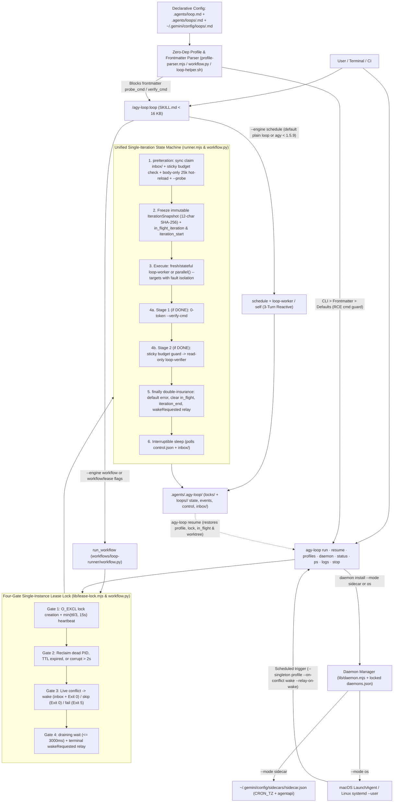
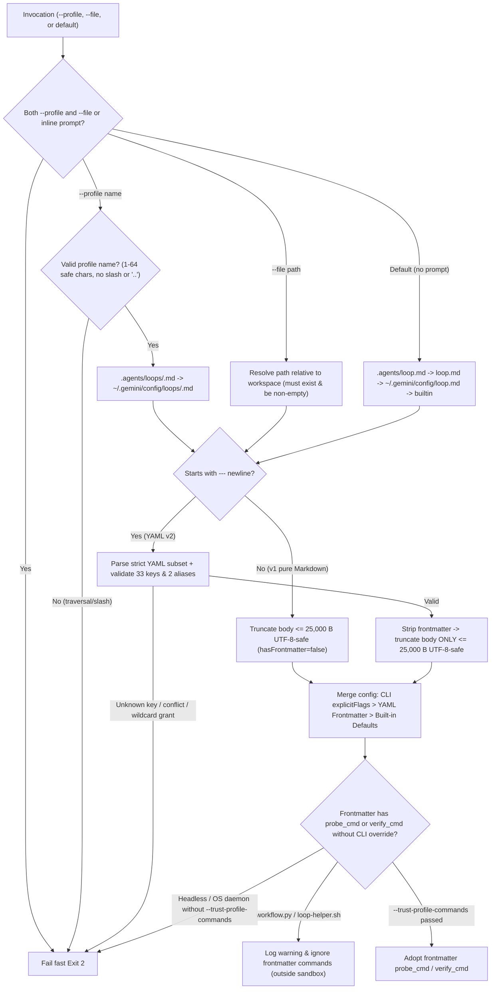
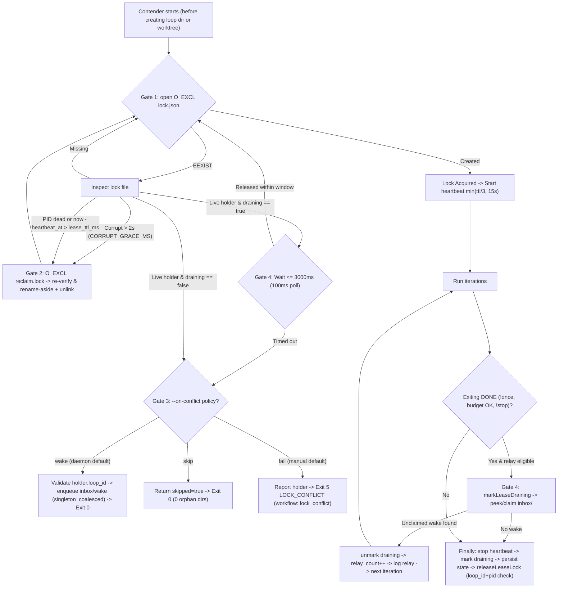
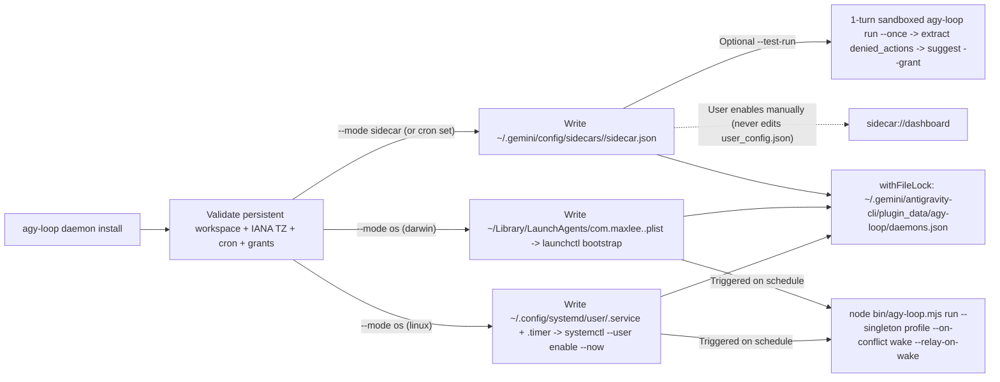
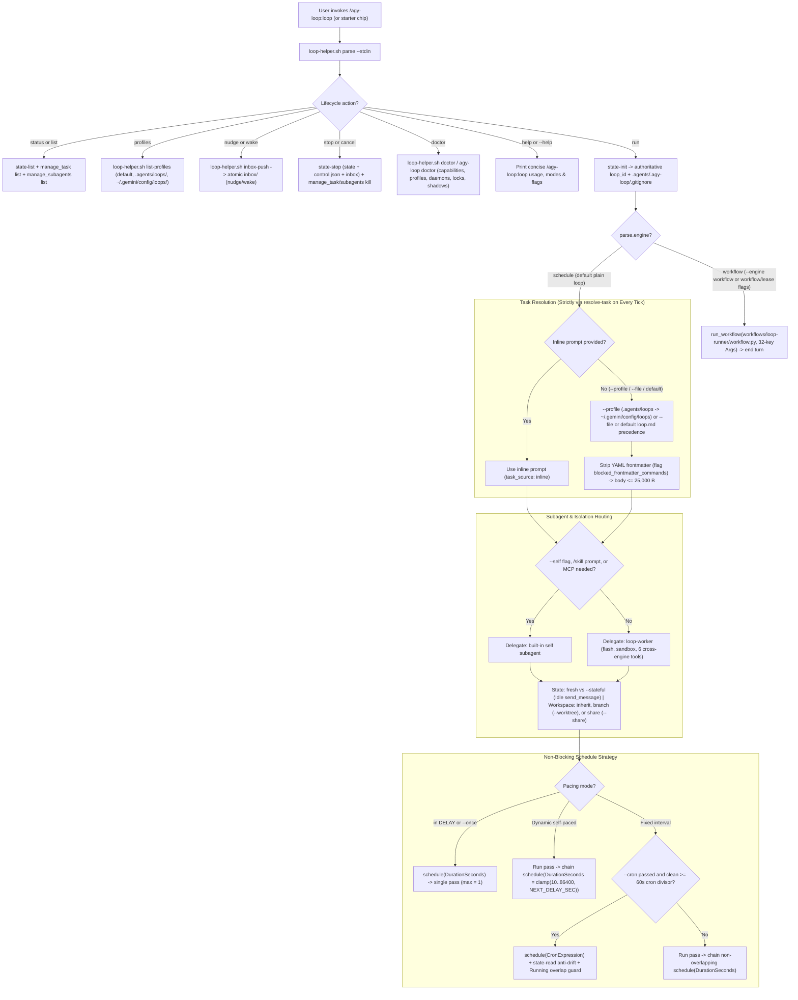
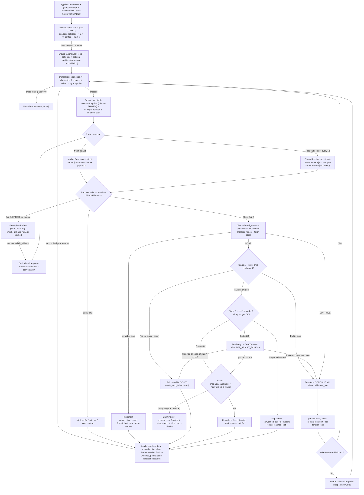

# `agy-loop` Technical Architecture

`agy-loop` (`v2.0.0`) implements a repository-scoped, multi-profile, singleton-safe, cross-reboot loop automation platform for **Google Antigravity Desktop** and **Antigravity CLI (`agy`)**. Combining a dual-engine interactive `/agy-loop:loop` scheduler (**`schedule` reactive timers** + **`run_workflow` dynamic Python engine** for `agy >= 1.5.9`), declarative **Multi-Profile YAML v2** configuration, a byte-compatible **Four-Gate Single-Instance Lease Lock** (`Node` & `Python`), cross-reboot **Sidecar & OS Service Daemons**, an independent read-only **`loop-verifier`**, and a zero-dependency **Headless CLI Runner** (`agy-loop run | resume | nudge | wake | profiles | daemon | status | ps | logs | stop | statusline`), `agy-loop` enforces strict sandbox and RCE boundaries while sharing `<workspace>/.agents/.agy-loop/` (automatically `.gitignore`d) across all engines.

---

## 1. Repository Layout & Component Overview

```text
agy-loop/
├── plugin.json                              # Strict Antigravity v1 plugin manifest (additionalProperties: false)
├── hooks.json                               # SessionStart shadow & skills.json filter detector (0 tokens when clean)
├── package.json                             # Zero-dependency npm CLI bridge & headless runner manifest (Node >= 18 ESM)
├── bin/
│   └── agy-loop.mjs                         # npm <-> `agy plugin` installer, shadow cleaner, doctor, remote validate & v2.0 CLI router
├── lib/
│   ├── duration.mjs                         # Single/compound duration parser, Go duration & compact token formatters
│   ├── profile-parser.mjs                   # Multi-profile discovery, strict YAML frontmatter v2 parser, sidecar grant & cron/IANA validation
│   ├── lease-lock.mjs                       # Four-gate single-instance lease lock (O_EXCL, heartbeat, stale reclaim, wake coalescing, draining)
│   ├── daemon.mjs                           # Persistent Sidecar (CRON_TZ + agentapi), macOS LaunchAgent & Linux systemd --user manager
│   ├── parse-run-args.mjs                   # `agy-loop run` CLI parser + explicitFlags tracker (--profile/--file/--singleton/--on-conflict/--trust-profile-commands/--relay-on-wake)
│   ├── schemas.mjs                          # Iteration & verifier JSON Schemas, prompt builders (nudges, Stage 1 summary) & outcome guards
│   ├── error-policy.mjs                     # AGY_ERROR parser, failure classifier, backoff & usage delta/budgets
│   ├── models.mjs                           # `agy models` catalog parser, slug/label resolver & Orchestrator check
│   ├── state-store.mjs                      # Unified .agents/.agy-loop/ store, inbox/ queue, O_EXCL locked index.json & daemons.json, loop.md/profile delegator
│   ├── worktree.mjs                         # Headless Git worktree creation, inspection & cleanup/merge hints
│   ├── json-client.mjs                      # Single-turn `agy --output-format json ... -p` transport client
│   ├── stream-client.mjs                    # Persistent bidirectional `stream-json` NDJSON `StreamSession`
│   ├── runner.mjs                           # Headless loop state machine, profile merge, 4-gate lease lock, wakeRequested relay, two-stage gate & resume
│   └── cli-commands.mjs                     # `run`, `resume`, `nudge`, `wake`, `profiles`, `daemon`, Option A `status`, `ps`/`list`, `logs`, `stop`, and `<5ms` `statusline`
├── agents/
│   ├── loop-worker.md                       # Isolated single-pass worker subagent (flash, sandbox, 6 cross-engine tools)
│   └── loop-verifier.md                     # Independent read-only verifier subagent (pro, sandbox, 3 read-only tools)
├── workflows/
│   └── loop-runner/                         # Zero-.md dynamic Python workflow bundle (agy >= 1.5.9 run_workflow)
│       ├── workflow.json                    # Strict 32-property `args` JSON Schema (additionalProperties: false)
│       └── workflow.py                      # Single-file Python 3.8+ stdlib runner (profiles, 4-gate lease lock, parallel targets, two-stage gate, inbox, budgets)
├── skills/
│   └── loop/
│       ├── SKILL.md                         # Session orchestrator skill (/agy-loop:loop, 15,708 B < 16 KB target / < 24 KB cap)
│       ├── scripts/
│       │   └── loop-helper.sh               # Pure POSIX sh parser (with explicit_flags), engine router, inbox-push, state-*, list-profiles, frontmatter-stripping resolve-task, hook & doctor (0755)
│       └── references/
│           ├── workflow-engine.md           # Progressive-disclosure run_workflow Args mapping, fallback, verify & targets guide
│           ├── profiles-and-daemons.md      # Progressive-disclosure YAML v2 frontmatter schema, templates, --trust-profile-commands, lease locks & daemons
│           └── examples-and-loop-md.md      # Progressive-disclosure templates, profiles/lease recipes & interactive TUI controls
├── docs/
│   ├── profiles-and-daemons.md              # User guide: multi-profile YAML v2, --trust-profile-commands, 4-gate lease locks & cross-reboot daemons
│   ├── headless-cli.md                      # User guide: Headless CLI runner, steering (nudge/wake), resume, statusline & exit codes
│   └── operations.md                        # User guide: run_workflow engine, two-stage verifier, reliability, stop paths & diagnostics
├── assets/
│   └── logo.svg                             # 128x128 square Marketplace icon
├── install.sh                               # Pure POSIX one-line & in-place (--clean-shadow) installer (UTC backups)
├── uninstall.sh                             # Pure POSIX clean uninstaller
└── tests/
    ├── plugin.test.mjs                      # Isolated HOME unit, contract, hook, doctor & strict-validator test suite
    ├── workflow.test.mjs                    # Workflow JSON schema & mock-runtime Python state-machine suite
    ├── headless.test.mjs                    # Mock-agy dual-transport, inbox, snapshot, two-stage gate, resume & CLI suite
    ├── v2.test.mjs                          # YAML v2 profile-parser, 4-gate lease lock, Sidecar/LaunchAgent/systemd daemon & v2 CLI suite
    └── live.test.mjs                        # Opt-in live `agy` CLI integration suite (AGY_LIVE_TEST=1)
```

### High-Level Architecture & Cross-Engine v2.0 Control Plane



### Component Overview & Separation of Responsibilities

1. **Layer 1: Session Orchestrator (`skills/loop/SKILL.md`)**
   - Activated in the primary session when the user invokes `/agy-loop:loop` (or clicks one of the 3 `suggestedPrompts` chips in Antigravity Desktop).
   - Keeps its total size at `15,708` bytes (under the `16,000`-byte target and well below Antigravity's `24,000`-byte `SKILL.md` truncation ceiling) by offloading `run_workflow` details to [workflow-engine.md](skills/loop/references/workflow-engine.md), YAML v2 schemas / lease locks / daemons to [profiles-and-daemons.md](skills/loop/references/profiles-and-daemons.md), and extended recipes/TUI guides to [examples-and-loop-md.md](skills/loop/references/examples-and-loop-md.md).
   - Routes Phase 0 lifecycle actions (`status`, `stop`, `nudge`, `wake`, `profiles`, `doctor`, `help`) and initializes authoritative state (`state-init`) before branching on `parse.engine` (`workflow` via `run_workflow` vs `schedule` via 3-Turn Reactive Protocol).
2. **Layer 2: Isolated Workers & Read-Only Verifier (`agents/loop-worker.md`, `agents/loop-verifier.md`, `self`)**
   - `loop-worker` (`subagent: true`, `mainAgent: false`, `model: flash`, `commandExecutionPolicy: sandbox`) pins the **6-tool cross-engine intersection** (`view_file`, `write_to_file`, `replace_file_content`, `run_command`, `manage_task`, `search_web`).
   - `loop-verifier` (`subagent: true`, `mainAgent: false`, `model: pro`, `commandExecutionPolicy: sandbox`) enforces a **strict 3-tool read-only subset** (`view_file`, `run_command`, `search_web`), physically removing write tools and scheduling primitives, and returns fail-closed `{ passed, summary, issues }`.
   - Built-in **`self`** subagent is selected whenever `--self` is passed, when the prompt starts with `/`, or when MCP/browser tools are needed.
3. **Layer 3: Dynamic Python Workflow Engine (`workflows/loop-runner/`)**
   - `workflow.json` validates **32** typed/nullable arguments (`additionalProperties: false`, `required: ["workspace_dir"]`) before `agy >= 1.5.9` starts `workflow.py`.
   - `workflow.py` (Python 3.8+ stdlib, zero external dependencies, zero `.md` files in `workflows/`) mirrors `lib/profile-parser.mjs` and `lib/lease-lock.mjs`, drives the entire multi-turn loop asynchronously in the background, reduces a 20-iteration interactive loop from ~41 main-chat turns down to **2 turns (~95% fewer main-chat turns)**, and strictly blocks untrusted frontmatter commands.
4. **Layer 4: Deterministic POSIX Control Plane (`skills/loop/scripts/loop-helper.sh`)**
   - Pure `#!/bin/sh` + `POSIXLY_CORRECT=1 LC_ALL=C awk` (`0755`, zero Node/Python dependencies) providing `parse` (with `workflow`, `--profile`, `--file`, `--singleton`, `--on-conflict`, `profiles`, `nudge`/`wake` subcommands, conflict checks, and engine routing), `list-profiles` (`set -f` glob-safe enumeration), `resolve-task` (frontmatter stripping, `"blocked_frontmatter_commands"` flag, body-only `25,000`-byte UTF-8 cap), `inbox-push`, `state-*`, `session-start`, and `doctor`.
5. **Layer 5: Zero-Overhead `SessionStart` Guard & Dual-Habitat CLI (`hooks.json`, `bin/agy-loop.mjs`)**
   - `hooks.json` emits `{}` in `<5ms` (`0` tokens, strictly `protojson`-compliant for `agy v1.5.13+`) when clean, or `{ "injectSteps": [...] }` on shadows / `skills.json` filters.
   - `bin/agy-loop.mjs` handles `install`, `uninstall`, `validate` (local and `--remote [ref]`), `doctor` (shared `buildDoctorReport` with `profiles`, `activeLocks`, `daemons`, `verifierToolsCheck`, `workflowBundleCheck`), Option A `status`, and routes `run | resume | nudge | wake | profiles | daemon | ps | list | logs | stop | statusline`.
6. **Layer 6: Multi-Profile, Lease Lock, Daemon & Headless Engine (`lib/*.mjs`)**
   - Zero-dependency `Node >= 18` ESM layer providing `profile-parser.mjs`, `lease-lock.mjs`, `daemon.mjs`, `runner.mjs`, `state-store.mjs` (`O_EXCL`-locked `index.json` & `daemons.json`), and `cli-commands.mjs`.

---

## 2. Multi-Profile YAML v2 Pipeline & RCE Security Boundary

### 2.1 Profile Resolution, Parsing & Precedence (`lib/profile-parser.mjs`, `workflow.py`, `loop-helper.sh`)



1. **Strict Zero-Dependency YAML Subset (`parseProfileDocument`)**:
   - Distinguishes v1 pure Markdown (`hasFrontmatter: false`) from YAML v2 (`hasFrontmatter: true`) by checking leading `---\n` or `---\r\n` bytes prior to truncation.
   - Parses comments (`#`), single/double-quoted and bare scalars, booleans, integers, inline arrays (`["a", "b"]`), and block lists (`- item`) while rejecting nested mappings or block scalars (`|`, `>`).
   - Validates all 33 primary keys plus 2 mutually exclusive aliases (`model` -> `worker_model`, `max_tokens` -> `budget_tokens`) using Damerau-Levenshtein typo suggestions (`KEY_SYNONYM_HINTS` + distance `<= 3`), strict duration parsing (`parseDurationStrict`), 5-field cron parsing (`validateCronExpression`), IANA timezone checks (`validateIanaTimezone`), wildcard-free grant validation (`validateSidecarGrants`), and cross-field mutual exclusions (`once` + `max_iterations > 1`, `reset_every` without `state_mode: stateful`, `probe_until_pass` without `probe_cmd`).
   - Truncates **only** the Markdown body at `25,000` bytes (`LOOP_MD_MAX_BYTES`) without splitting multi-byte UTF-8 sequences, guaranteeing frontmatter metadata is never corrupted.
2. **CLI Precedence (`mergeProfileWithCli`)**:
   - `parseRunArgs` records every user-passed option (including interval tokens) in `explicitFlags: Set<string>`. `mergeProfileWithCli` merges **`Explicit CLI Flags > YAML Frontmatter > Built-in Defaults`** and runs post-merge consistency checks.
   - During execution, `runPreIteration` re-reads the profile/Markdown body on every pass while keeping structural startup config frozen.
3. **Clone-Safe RCE Security Boundary**:
   - **Headless CLI & OS Daemons**: Untrusted frontmatter `probe_cmd` / `verify_cmd` fail closed with Exit `2` unless overridden via CLI (`--probe` / `--verify-cmd`) or explicitly authorized via `--trust-profile-commands`.
   - **Interactive `run_workflow`**: Because `workflow.py` executes outside the OS sandbox, it **never** executes `probe_cmd` / `verify_cmd` from frontmatter under any circumstance; it logs an explicit warning (`Skipping untrusted frontmatter probe_cmd/verify_cmd in workflow mode`) and only honors explicit `Args.probe_cmd` / `Args.verify_cmd`. `loop-helper.sh resolve-task` likewise surfaces `"blocked_frontmatter_commands": true`.

---

## 3. Four-Gate Single-Instance Lease Lock (`wakeDriver`) & `wakeRequested` Relay

Both `lib/lease-lock.mjs` and `workflows/loop-runner/workflow.py` share an identical, byte-compatible lock protocol so a Headless run, an OS Daemon run, and an interactive `run_workflow` loop in the same workspace coordinate safely without overlapping runs or duplicate worktrees.

### 3.1 Byte-Compatible Lock Key & Record Schema

- **Scope Keys (`computeLockScope` / `compute_lock_scope`)**:
  - `"none"` -> `null` (default when `--profile` and `--file` are omitted in ad-hoc runs).
  - `"workspace"` -> `ws_` + first 16 hex chars of `SHA-256(realpath(workspaceDir))`.
  - `"profile"` -> `pf_` + first 16 hex chars of `SHA-256(realpath(workspaceDir) + "\0" + (profileName || "default"))` (default whenever `--profile`, `--file`, or `daemon --mode os` is used).
- **Lock Path & JSON Contract (`<stateRoot>/locks/<scope_key>.lock.json`, `0o600`)**:
  ```json
  {
    "scope": "profile",
    "scope_key": "pf_8c1d...",
    "loop_id": "lp_20261123T013000Z_a1b2",
    "pid": 41290,
    "engine": "headless",
    "profile": "ci",
    "workspace_dir": "/abs/realpath/to/repo",
    "acquired_at": "2026-11-23T01:30:00.123Z",
    "heartbeat_at": "2026-11-23T01:30:20.123Z",
    "lease_ttl_ms": 60000,
    "draining": false
  }
  ```
  *(Millisecond UTC ISO timestamps ensure sub-second TTL evaluations behave identically across Node and Python.)*

### 3.2 Four-Gate Protocol & Gate 4 Terminal `wakeRequested` Relay



- **Zero Orphan Artifacts on Conflict**: Because lock acquisition runs *before* `createLoopState` / `createHeadlessWorktree` in `runner.mjs` (and before `_init_or_adopt_state` / agent spawning in `workflow.py`, finalizing any pre-created `loop-helper.sh state-init` stub cleanly), `coalesced`, `skipped`, and `conflict` contenders leave zero orphan worktrees or spurious `running` state directories.
- **TOCTOU-Safe Gate 2 Reclaim & Ownership-Checked Mutations**: Gate 2 serializes stale/corrupt reclaim under a short-lived `O_EXCL` `${lockPath}.reclaim.lock` (shared dead-PID / 5s TTL protocol across Node & Python) and re-verifies staleness before rename-aside/unlink. `refreshLeaseHeartbeat`, `markLeaseDraining`, `unmarkLeaseDraining` / `unmark_lease_draining`, and `releaseLeaseLock` always re-read the lock file and verify `current.loop_id === handle.loopId && current.pid === handle.pid` while preserving `0o600` permissions.

---

## 4. Persistent Cross-Reboot Daemons (`lib/daemon.mjs`)

`lib/daemon.mjs` manages scheduled automations across reboots with zero external dependencies and strict namespace isolation (`agy-loop-*`):



1. **Deterministic Slug & Ephemeral Workspace Protection**:
   - `computeDaemonSlug(workspaceDir, profileName)` produces `agy-loop-<repo>-<profile>-<4hex>` using SHA-256 of `realpath(workspaceDir)\0profile`.
   - `validatePersistentWorkspace` rejects missing paths and ephemeral roots (`/tmp`, `/private/tmp`, `/var/folders`, `/private/var/folders`, `/google/src/cloud`) unless `--allow-temp-workspace` is explicitly passed for isolated testing.
2. **Native Antigravity Sidecar (`--mode sidecar`)**:
   - Emits strict snake_case `sidecar.json` matching Antigravity's `schedule` builtin contract: `"builtin": "schedule"`, `"args": ["CRON_TZ=<IANA> <5-field-cron>", "agentapi", "new-conversation", ...("--model=..."), "--title=...", "--", "<prompt>"]`, `"restart_policy": "always"`, `"display_name"`, `"description"`, and `"agent_permissions"`.
   - Strictly rejects wildcard grants (`command(*)`, `read_file(*)`, `read_file(/)`, `write_file(*)`, `mcp(*)`, `read_url(*)`, `execute_url(*)`, `allow(*)`, `(*)`, `/*`, `\*`, drive roots) with Exit `2`.
   - **Never writes or mutates `user_config.json` or `config.json`**; directs users to `sidecar://dashboard` and `agy remote-control status`.
   - Supports `--dry-run` and `--test-run` (executes a 1-turn sandboxed `runHeadlessLoop`, parses `denied` events from `events.jsonl`, and prints minimal non-wildcard `--grant` suggestions).
3. **OS Native Services (`--mode os`)**:
   - Always enforces `--trust-profile-commands` validation before registering OS services if frontmatter has `probe_cmd` / `verify_cmd`.
   - Embeds `--singleton <profile|workspace> --on-conflict wake --relay-on-wake` in generated `ProgramArguments` / `ExecStart` so overlapping ticks coalesce cleanly into `inbox/wake`.
   - **macOS `LaunchAgent`**: Escapes XML characters, expands 5-field cron into `StartCalendarInterval` dicts/arrays (capped at 512 entries) or sets `StartInterval`, logs to `<stateRoot>/daemons/<slug>.log`, and runs `launchctl bootout` + `launchctl bootstrap gui/<uid>` unless `--no-load`.
   - **Linux `systemd --user`**: Generates `Type=oneshot` `.service` and `Persistent=true` `.timer` (`OnCalendar=` or `OnBootSec=30s` + `OnUnitActiveSec=`) and runs `systemctl --user daemon-reload && systemctl --user enable --now` unless `--no-load`.
4. **Locked Registry (`daemons.json`) & Safe Cleanup**:
   - `upsertDaemonEntry` / `removeDaemonEntry` serialize updates via `withFileLock` on `${registryPath}.lock` (honoring `AGY_LOOP_DAEMON_REGISTRY_PATH` and `AGY_LOOP_STATE_DIR` test isolation).
   - `listDaemons` merges registry records with on-disk probes (`~/.gemini/config/sidecars/agy-loop-*`, `com.maxlee.agy-loop-*.plist`, `agy-loop-*.timer`) and optional live `launchctl list` / `systemctl --user is-active` checks (`status` mode). `removeDaemon` unloads and deletes only `agy-loop-*` artifacts.

---

## 5. Three-Turn Reactive Non-Blocking Loop Lifecycle (`schedule` Engine)

When `parse.engine == "schedule"` (plain `/agy-loop:loop` or explicit `--engine schedule`), both `invoke_subagent` and `schedule` are **asynchronous background primitives**. Ending the orchestrator's turn immediately after calling either tool parks the session at **zero token cost** and leaves the main prompt free until a reactive wake-up arrives.

```mermaid
sequenceDiagram
  actor User
  participant Main as "Main Session (loop SKILL.md)"
  participant Helper as "POSIX Helper (loop-helper.sh)"
  participant State as "State Store (.agents/.agy-loop/)"
  participant Worker as "Subagent (loop-worker / self)"
  participant Sched as "Native Scheduler (schedule / manage_task)"

  rect rgb(15, 23, 42)
  Note over User,Sched: Turn A - Non-Blocking Dispatch Turn
  User->>Main: /agy-loop:loop check PR CI and fix failures --stateful
  Main->>Helper: parse --stdin & state-init --stdin
  Helper->>State: Create .gitignore + loops/<loop_id>/state.json (iter=1)
  Helper-->>Main: loop_id (lp_...)
  Main->>Worker: invoke_subagent (Iteration 1/20, clean context)
  Main->>Helper: state-update (worker_id, task_id)
  Main-->>User: Dispatched Loop [lp_...] #1/20 - Yield turn immediately
  end

  par Worker executes single pass in isolated context
    Worker->>Worker: Run check / apply minimal fix / verify once
  and Main chat remains unlocked at zero polling cost
    User->>Main: Normal unrelated coding question
    Main-->>User: Immediate response (zero build/CI log noise)
  end

  rect rgb(15, 23, 42)
  Note over User,Sched: Turn B - Reactive Subagent Wake-up Turn
  Worker-->>Main: Completion message + 4-line contract (CONTINUE, 45s)
  Main->>Helper: state-read (check stop_requested, consecutive_errors)
  alt Valid contract & CONTINUE & iteration < max_iterations
    Main->>Main: Clamp delay to [10, 86400] (dynamic) or interval_sec (fixed)
    Main->>Sched: schedule(DurationSeconds=45, compact [LOOP_WAKEUP] with loop_id)
    Sched-->>Main: Scheduled TaskId
    Main->>Helper: state-update --increment-iteration --reset-errors --stdin
    Main-->>User: [Loop lp_... #1/20] SUMMARY | Next wake-up in 45s - Yield turn
  else 3 consecutive errors or DONE or BLOCKED or stop_requested or max_iterations
    Main->>Sched: manage_task(Action="kill", TaskId)
    Main->>Helper: state-update (terminal status: done|blocked|stopped|max_reached|circuit_broken)
    Main-->>User: Final summary, worktree diff/merge instructions (if branch) & clean stop
  end
  end

  Note over Sched: Background timer sleeps at 0 tokens/sec (User can keep chatting)

  rect rgb(15, 23, 42)
  Note over User,Sched: Turn C - Timer / Cron Wake-up Turn (Repeats Turn B -> Turn C)
  Sched-->>Main: [LOOP_WAKEUP] (loop_id, skill_dir, workspace_dir + fallback)
  Main->>Helper: state-read (authoritative iteration, next_hint, worker_id, stop_requested)
  Main->>Helper: resolve-task (re-reads loop.md / profile body when task_source != inline)
  Main->>Worker: send_message to Idle worker_id (or invoke_subagent if fresh)
  Main-->>User: Yield turn immediately
  end
```



*(For one-shot invocations such as `/agy-loop:loop in 20m <task>` or `/agy-loop:loop --once 10m <task>`, Turn A creates `state.json`, schedules `DurationSeconds` directly with `max_iterations = 1`, records `task_id`, and dispatches the single subagent pass when the timer fires.)*

---

## 6. Task, Engine, Subagent & Pacing Resolution Flow



### Why Chained `DurationSeconds` Is the Default Over Raw Cron

Even when a fixed interval is `>= 60s` (for example `/agy-loop:loop 5m run integration suite` or `/agy-loop:loop every 2m30s check build`), `loop-helper.sh` computes `cron_expr` (`*/5 * * * *`) when cleanly mappable but keeps `use_cron: false` unless `--cron` is explicitly passed:

1. **Zero Overlapping Runs**: Chaining a one-shot `schedule(DurationSeconds=...)` *after* the subagent finishes guarantees Iteration `N+1` never starts while Iteration `N` is still compiling or running tests.
2. **Sub-Minute, Compound & Non-Divisor Precision**: `DurationSeconds` handles `15s`, `30s`, `2m30s`, `1h30m`, or `7m` natively without rounding to 5-field cron boundaries (fractional inputs like `1.5m` fail fast with Exit `2` suggesting `90s` / `1m30s`).
3. **Opt-In Wall-Clock Cron (`--cron`)**: When wall-clock cadence is desired (`1m` -> `* * * * *`, `Nm` dividing `60` -> `*/N * * * *`, `60m`/`1h` -> `0 * * * *`, `Nh` dividing `24` -> `0 */N * * *`, `24h`/`1d` -> `0 0 * * *`), `--cron` enables `CronExpression` with optional `--exact` (`ExactTiming: true`) and `--daemon` (`IsDaemon: true`). Turn C reads `iteration`, `next_hint`, `worker_id`, and `stop_requested` from `.agents/.agy-loop/loops/<loop_id>/state.json` via `state-read`, completely eliminating static cron prompt drift.

---

## 7. Worker Output Contract, Circuit Breaker & Externalized State Store

### 4-Line Plain-Text Footer Contract, Delay Clamp & Circuit Breaker

In `schedule` mode (and as a fallback parser in headless `json` mode), `loop-worker` (or loop-delegated `self`) ends with four plain-text key-value lines **without surrounding Markdown code fences**:

```text
LOOP_STATUS: DONE | CONTINUE | BLOCKED
NEXT_DELAY_SEC: <integer seconds>
SUMMARY: <concise 1-line summary of current state and actions taken>
NEXT_HINT: <brief context or focus point for the next iteration, or None>
```

- **Why Fence-Free Plain Text**: Key-anchored plain text at the tail of the worker message avoids nested Markdown fence breakages whenever summaries contain backticks.
- **Delay Validation & Clamping (`[10, 86400]`)**: Delays default to `120s` if missing, non-integer, or negative, and clamp dynamic self-paced intervals to `min(86400, max(10, NEXT_DELAY_SEC))`.
- **3-Error Consecutive Circuit Breaker**: Missing/invalid outcomes or unrecoverable errors increment `consecutive_errors` in `state.json` (resetting to `0` on valid passes). Reaching `consecutive_errors >= 3` (`--max-errors`) marks `status: "circuit_broken"`, cancels active schedules, and stops cleanly with diagnostics.

### Sandbox-Safe Unified Control Plane (`.agents/.agy-loop/`) & Locked Global Stores

In `agy v1.5.7+` default `auto` mode, OS-sandboxed `run_command` grants write access only to workspace roots, `ArtifactDirectoryPath`, and OS temp/caches — blocking writes to `~/.gemini/antigravity-cli/plugin_data/`. To guarantee zero sandbox denials while uniting `schedule`, `workflow`, and `headless` runs:

- **Workspace-Scoped Isolation**: All three engines store per-loop state under `${AGY_LOOP_STATE_DIR:-<workspace>/.agents/.agy-loop}/loops/<loop_id>/` (`state.json`, append-only `events.jsonl`, `control.json`, and `inbox/`) plus lease locks under `<state_root>/locks/<scope_key>.lock.json` and OS daemon logs under `<state_root>/daemons/<slug>.log`, using UTC + random hex IDs (`lp_YYYYMMDDTHHMMSSZ_<4hex>`, validated against `^lp_[A-Za-z0-9_-]{4,64}$`).
- **Zero Git Pollution**: `state-init`, `ensureStateRoot`, and `ensure_state_root` atomically create `*` in `<state_root>/.gitignore` via `wx` / `O_EXCL` so neither `git status` nor `agy v1.5.5+` dirty-file worktrees pick up runtime state files.
- **Atomic `inbox/` Control Queue (`nudge` / `wake` / `stop`)**:
  - Writers (`enqueueInboxMessage` in Node, `enqueue_inbox_message` in Python, `inbox-push` / `state-stop` in `loop-helper.sh`) write JSON records to a temp file and atomically rename into `<loop_dir>/inbox/<epoch>_<pid>_<hex>.json` (preserving `reason` and `source_pid` on coalesced `wake` messages).
  - `peekInboxFlags` / `peek_inbox_flags` scans pending `inbox/*.json` non-destructively during inter-iteration sleep, post-turn checks, and Gate 4 terminal `wakeRequested` relay.
  - `claimInboxMessages` / `claim_inbox_messages` reads sorted `inbox/*.json` at `preIteration` (and during relay), atomically renames each into `inbox/claimed/` (pruning retention to the latest 100 files) so every message is delivered at most once without write-write races.
  - `writeControlStop` dual-writes `control.json` and an `inbox/` `stop` message; `clearControlStop` cleans both before `resume`.
- **Cross-Process `O_EXCL`-Locked Global Index (`index.json`) & Daemon Registry (`daemons.json`)**:
  - Non-isolated `workflow` and `headless` runs upsert into `~/.gemini/antigravity-cli/plugin_data/agy-loop/index.json` (200-entry cap, `AGY_LOOP_INDEX_PATH` override; automatically bypassed when `AGY_LOOP_STATE_DIR` / `state_dir` isolates tests).
  - Persistent daemon registrations upsert into `~/.gemini/antigravity-cli/plugin_data/agy-loop/daemons.json` (`AGY_LOOP_DAEMON_REGISTRY_PATH` override, or `<AGY_LOOP_STATE_DIR>/daemons.json` when isolated).
  - Both `lib/state-store.mjs` (`withFileLock`) and `workflows/loop-runner/workflow.py` (`with_file_lock`) share the exact same `${targetPath}.lock` `O_EXCL` lock protocol (`{ pid, acquired_at }`), reclaiming locks whose holder PID is dead (`isPidAlive` / `is_pid_alive`) or whose `mtime` exceeds `10s` (`staleMs = 10000` / `stale_sec = 10.0`), with jittered backoff.

---

## 8. Customization Precedence, Option A `status`, `doctor` & Remote Validation

Antigravity discovers skills and subagents in strict precedence order (highest to lowest):

1. **Workspace Project** (`.agents/`, `.agent/`, `_agents/`, `_agent/` walking up to repository root)
2. **Workspace Declared JSON** (`.agents/skills.json`, `.agents/plugins.json`)
3. **Global User Discovery** (`~/.gemini/config/skills/`, `~/.gemini/config/agents/`, plus CLI-specific `~/.gemini/antigravity-cli/skills/` and `~/.gemini/skills/`)
4. **Built-in Customizations** (`~/.gemini/antigravity-cli/builtin/`)
5. **Installed Plugins & Global Declared JSON** (`~/.gemini/config/plugins/agy-loop/`)

### Guardrails Against Silent Discovery & Runtime Failures

- **Pure Plugin Namespacing (`/agy-loop:loop`)**: Registers consistently across Desktop Marketplace and CLI (`agy`) without scattering files into `~/.gemini/config/`.
- **Strict `protojson` `SessionStart` Hook (`hooks.json`)**: Under `agy v1.5.13+` (verified on `v1.5.14`), plugin hooks use strict `protojson` unmarshaling and reject echoed stdin fields (such as `artifactDirectoryPath`). `loop-helper.sh session-start` emits `{}` (`0` tokens, `<5ms`) when clean, or strictly `{ "injectSteps": [...] }` when Tier 3 shadow files or `skills.json` `include_only`/`exclude` filters (matched with POSIX ERE parity against `bin/agy-loop.mjs`) block `/agy-loop:loop`.
- **Unified UTC `--clean-shadow` Archiving**: `bin/agy-loop.mjs`, `loop-helper.sh`, and `install.sh` all archive colliding Tier 3 files into `~/.gemini/config/.agy-loop-backup-YYYYMMDD-HHMMSSZ/` with cross-filesystem fallback.
- **Option A `agy-loop status` Overview (`handleStatusOverview`)**:
  - Upgraded in `v2.0.0` from a `doctor` alias to a unified runtime overview combining `activeLoops`, `daemons` (checked with `checkStatus: true` for live `launchctl`/`systemctl` load state), `activeLocks` (`listLeaseLocks`), and concise `health` (derived from shared `buildDoctorReport({ allowMissingAgy: true })`). `--json` preserves top-level `ok: health.ok`.
- **Upgraded `doctor` Diagnostics (`npx agy-loop doctor [--json]`)**:
  - **`agy.capabilities`**: Parses `agy --version` into a version capability matrix (`printTimeout`, `sidecarHomeExpansion`, `worktreeDirtyCarry`, `autoModeDefault`, `dynamicWorkflows`, `githubUrlValidate`, `strictProtojsonHooks`).
  - **Enterprise & Policy Audit (`environment`, `environmentWarnings`)**: Non-secret read-only inspection of `~/.gemini/config/admin_settings.json`, `~/.gemini/antigravity-cli/settings.json`, and static `hooks.json` matcher structures (`PreToolUse`/`PostToolUse` grouping).
  - **Agent, Workflow, Hook & v2.0 Runtime Self-Tests**:
    - `hookSelfTest`: runs `SessionStart` against synthetic `v1.5.14` `artifactDirectoryPath` stdin checking zero leaked keys.
    - `agentToolsCheck` & `verifierToolsCheck`: validates `loop-worker` (6 dual-engine tools) and `loop-verifier` (3 strictly read-only tools).
    - `workflowBundleCheck`: validates `workflows/loop-runner/workflow.json` (`entry` containment, `args.type === "object"`), `workflow.py`, and zero `.md` files under `workflows/`.
    - `activeLoops`, `profiles` (`count`, `validCount`, `invalidCount`, `items`), `activeLocks`, and `daemons` (`total`, `workspace`, `sidecar`, `os`, `items`).
- **Strict Local & Remote GitHub Validation (`agy-loop validate [--remote [ref]] [--json]`)**:
  - Local mode validates `PLUGIN_ROOT` with `agy plugin validate --strict [--json]`.
  - `--remote [ref]` defaults `<ref>` to `v<version>` (rejecting invalid/traversal refs with Exit `2`) and invokes `agy plugin validate --strict [--json] https://github.com/maxlee/agy-loop/tree/<ref>` **without a trailing `/.`**, matching `.github/workflows/release.yml`.

---

## 9. Subagent Dual-Engine Tool Split, Sandbox & Worktree Safety

1. **Exact Dual-Engine Tool Split (`loop-worker`: 6 Tools vs `loop-verifier`: 3 Read-Only Tools)**
   - In `agy v1.5.13+` (verified on `v1.5.14`), CLI `oneharness` (`DeclarativeConfigLoader.Load` / `ConstructFromRegistry`) treats unmapped tool names in `agents/*.md` as a **fatal component-load error** (`not found in registry`), whereas Desktop Cortex registers legacy tool identifiers (`view_file`, `write_to_file`, `replace_file_content`), which `oneharness` forward-canonicalizes (`view_file -> read_file`, `write_to_file -> write_file`, `replace_file_content -> edit_file`).
   - **`agents/loop-worker.md` (`model: flash`, `commandExecutionPolicy: sandbox`)** pins the **6-tool cross-engine verified intersection**:
     `view_file`, `write_to_file`, `replace_file_content`, `run_command`, `manage_task`, and `search_web` (`send_message` is injected automatically). The 4 legacy Cortex-only tools (`multi_replace_file_content`, `list_dir`, `find_by_name`, `grep_search`) stay removed; directory listing and code search run cleanly via sandboxed `run_command` (`rg`, `grep`, `find`, `ls`).
   - **`agents/loop-verifier.md` (`model: pro`, `commandExecutionPolicy: sandbox`)** pins the **strictly read-only 3-tool subset**:
     `view_file`, `run_command`, and `search_web`. Write tools (`write_to_file`, `replace_file_content`) and scheduling/delegation tools (`manage_task`, `schedule`, `invoke_subagent`) are physically excluded.
2. **CLI Roster Hygiene (`mainAgent: false`)**
   - Keeps both `loop-worker` and `loop-verifier` scoped to orchestrators and `/agents` without cluttering `agy agents` or `agy --agent <name>` primary session selectors.
3. **Sandbox Execution & Prompt-Injection Defense**
   - Shell commands inside subagents run under Antigravity's OS sandbox (`commandExecutionPolicy: sandbox`). Both `loop-worker` and `loop-verifier` treat repository text, diffs, build logs, probe output, and web search results as untrusted data.
4. **Git Worktree Isolation & Preservation (`--worktree` -> `Workspace: "branch"`, `v1.5.5+`)**
   - In `agy v1.5.5+`, `Workspace: "branch"` worktrees inherit staged, unstaged, and untracked changes from the parent checkout. `loop-worker` distinguishes pre-existing dirty files from its own verified edits and commits fixes locally without pushing.
   - `SKILL.md` records `worktree_branch` in `state.json`, surfaces branch name, `git diff --stat`, and `git cherry-pick` / `git merge` commands before teardown, and keeps the `branch` subagent `Idle` if unmerged commits await review.
5. **Bounded File & Quota Safeguards**
   - `loop-helper.sh resolve-task` / `resolveProfileTask` / `resolve_profile_task` enforce a `25,000`-byte UTF-8-safe cap on the Markdown body only, `--max 20` caps default iterations, and the 3-error circuit breaker halts stuck loops automatically.

---

## 10. Headless Dual-Transport & State Consistency Architecture (`v2.0.0`)

`agy-loop` extends the interactive scheduler into a deterministic, zero-dependency headless CLI runner (`agy-loop run | resume | nudge | wake | profiles | daemon | status | ps | logs | stop | statusline`) verified against **`agy v1.5.14`**, sharing multi-profile resolution, Four-Gate Lease Locks, and `.agents/.agy-loop/` state.



### 10.1 Dual-Transport Execution (`fresh` vs `--stateful`)

1. **`fresh` Single-Turn JSON Transport (`lib/json-client.mjs`)**:
   - Invokes `agy --output-format json --json-schema <iter-schema.json> --print-timeout <dur> [flags] -p "<prompt>"` per iteration with **all CLI flags strictly preceding `["-p", prompt]`**.
   - Avoids `--agent loop-worker` (which exits `1` in `-p` mode because `mainAgent: false`) and instead carries the single-pass discipline directly in `buildWorkerPrompt` + `ITERATION_RESULT_SCHEMA`.
   - Uses string-aware outermost brace scanning (`parseJsonEnvelope`), paired with an outer safety watchdog (`turnTimeoutSec + 60s`) and `AbortSignal` termination (`SIGTERM` + 5s `SIGKILL` fallback).
2. **`--stateful` Persistent `stream-json` Transport (`lib/stream-client.mjs`)**:
   - Spawns a long-lived bidirectional NDJSON process via `agy --input-format stream-json --output-format stream-json --json-schema <iter-schema.json> [flags]` — **never passing `-p` / `--print`** (which causes `agy` Exit `2`).
   - Captures `conversation_id` on `event === "init"`, feeds turns via `{"event":"user","message":{"content":...}}`, rotates processes every `--reset-every <N>` turns (seeding `next_hint` via `formatActionableSeedHint` and logging `session_reset`), and closes gracefully via `stdin.end()`.
   - **Cumulative Usage Delta Accounting (`computeUsageDelta`)** and **Stale `structured_output` Guard (`extractIterationOutcome`)** protect per-turn telemetry and guard against stale carryover across turns (`iteration` nonce + `finish` step tracking).
   - **Automatic `--conversation` Respawn on Exit `3`**: Closes failed sessions and respawns `StreamSession` with `--conversation <saved_id>` (and `--fallback-model` when switching).
3. **Model Catalog & Minimal-Permission Flag Routing (`lib/models.mjs`, `buildAgyCommonFlags`)**:
   - Queries `agy --output-format json models`, resolves slugs or display labels with edit-distance hints (`exit 2`), omits `--effort` for `Orchestrator` models, passes `--disable-slash-commands` unless `--allow-slash-commands`, and inherits the user's configured `agy` mode unless overridden.

### 10.2 Cross-Engine State Consistency, Checkpointing & `resume`

- **Frozen `IterationSnapshot` & Paired Checkpoints**:
  - `runPreIteration` claims `inbox/` (`inbox_claim` event), checks stop and budgets, resolves profile/Markdown body, runs bounded `--probe`, and builds an `Object.freeze`d `IterationSnapshot` with a 12-char SHA-256 `snapshotHash`.
  - Before invoking the worker, `runner.mjs` sets `in_flight_iteration` + `in_flight_snapshot_hash` in `state.json` and emits `iteration_start`. A per-iteration `try / finally` unconditionally clears `in_flight_*` and writes `iteration_end` (`outcome`, `duration_ms`, `usage_delta`).
- **`finally` Double-Insurance Error Terminal State**:
  - `executeHeadlessLoop` initializes `finalStatus = "error"`, `exitReason = "unhandled_exception"`, `exitCode = EXIT_CODES.ERROR` (never `"done"`). Outer `finally` stops the lease heartbeat, marks `draining: true`, finalizes worktree/state, and releases the lease lock safely.
- **Two-Stage `turn-stopping` Gate & Sticky Hard-Budget Guard (`runTwoStageGate`)**:
  - Stage 1 runs `--verify-cmd` (`0` LLM tokens, `60s` default timeout, `4096 B` UTF-8 tail, `verify_cmd` event). Failures short-circuit Stage 2 and inject failure details into `next_hint` (or fail closed `BLOCKED` `verify_cmd_failed` Exit `3` at `--max`/`--once`).
  - Stage 2 enforces a **sticky budget check** (`maxDurationSec`, `maxTokens`) before calling `--verifier-model`. Once exhausted, Stage 2 is skipped (`skipped_due_to_budget: true, unverified_due_to_budget: true`) and exits cleanly with `status: "max_reached"` (`exit 4`).
- **Checkpoint Recovery (`resumeHeadlessLoop` / `agy-loop resume`)**:
  - Accepts `stopped`, `max_reached`, `blocked`, `circuit_broken`, `error`, or `running` loops with dead PIDs (`[stale]`); rejects `done` or non-headless loops (`exit 2`) and live running PIDs (`exit 1`).
  - Reconciles orphan `in_flight_iteration != null` by writing an `iteration_end` (`outcome: "interrupted"`) record and resuming from that interrupted iteration.
  - Verifies and reattaches `worktree_path` / `worktree_branch` (fail-fast `exit 2` if missing), restores `profileName`, `profilePath`, `singleton`, `relayCount`, `savedConversationId`, `usage_totals`, `denied_actions_count`, `next_hint`, and `active_model`, re-acquires the Four-Gate Lease Lock, clears old `control.json` / `inbox/` stops, and merges `run_config_snapshot` (explicitly stripped of `settingsArg`/`settings`).
  - **Explicit Budget Extension Guard**: When `prev.status === "max_reached"`, requires a strictly higher `--max`, `--max-tokens`, or `--max-duration` override matching the exhausted budget (otherwise fails fast with `exit 2`).

### 10.3 `AGY_ERROR` Policy, Soft-Denials, `--probe` & `--worktree`

1. **`AGY_ERROR` Parsing & Exit Codes (`lib/error-policy.mjs`)**: Exit `1`/`2` -> `fatal_config` (`0` retries); Exit `3` + quota/capacity -> `--fallback-model`; non-retryable quota -> `BLOCKED` (`exit 3`); `print_timeout`/transient -> jittered retry (`30s -> 60s -> 120s`); budgets -> `max_reached` (`exit 4`); lease conflict -> `LOCK_CONFLICT` (`exit 5`); `SIGINT`/`SIGTERM`/`stop` -> `stopped` (`exit 130`).
2. **Soft-Denial (`denied_actions[]`) Auditing**: Increments `denied_actions_count`, emits `denied` events (inspected by `agy-loop daemon install --test-run` to suggest scoped grants), and fails closed `BLOCKED` (`exit 3`) when `--fail-on-denied` is enabled.
3. **Zero-Token `--probe` Preflight**: Runs bounded shell command (`--probe-timeout`, `60s` default); under `--probe-until-pass`, exit `0` finishes `DONE` at `0` tokens (`exit 0`).
4. **Headless Git `--worktree` Lifecycle (`lib/worktree.mjs`)**: Creates `agy-loop/<loop_id>` at `<stateRoot>/worktrees/<loop_id>`; cleans untouched clean worktrees (unless `--keep-worktree`) or preserves modified/committed branches with `git merge` / `git cherry-pick` hints.

---

## 11. Dynamic Python Workflow Engine (`workflows/loop-runner/`)

For interactive `/agy-loop:loop` runs requiring two-stage verification, probes, parallel targets, hard token/duration budgets, periodic stateful rotation, or single-instance lease locks on `agy >= 1.5.9`, `SKILL.md` delegates the entire loop lifecycle to `workflows/loop-runner/workflow.py` via `run_workflow`.

### 11.1 `workflow.json` Contract & Top-Level `await` Runtime

- **`workflows/loop-runner/workflow.json`**: Declares `name: "loop-runner"`, `entry: "workflow.py"`, and a strict JSON Schema (`additionalProperties: false`, `required: ["workspace_dir"]`) validating all **32** parameters (`loop_id`, `workspace_dir`, `task_source`, `prompt`, `pacing`, `once`, `interval_sec`, `max_iterations`, `state_mode`, `reset_every`, `workspace`, `model`, `delegate`, `verify`, `verifier_model`, `verify_cmd`, `verify_timeout_sec`, `probe_cmd`, `probe_timeout_sec`, `probe_until_pass`, `targets`, `max_tokens`, `max_duration_sec`, `max_agents`, `max_errors`, `include_trajectory`, `state_dir`, `profile`, `profile_file`, `singleton`, `on_conflict`, `relay_on_wake`).
- **Active Event-Loop Execution**: `agy v1.5.14` executes `workflow.py` inside an active asyncio event loop where `asyncio.run()` would fail; therefore `workflow.py` exposes testable `run_loop_workflow(wf_args, runtime)` and activates `if "agent" in globals(): await _run_workflow_main()` (validated with Python's `ast.PyCF_ALLOW_TOP_LEVEL_AWAIT` compiler flag rather than `py_compile`).

### 11.2 Profiles, Lease Locks, Parallel Target Isolation & Security Boundary

1. **Native Primitives**:
   - Uses `phase(f"Iteration {iteration}/{max_iterations}")`, `log()`, `agent(..., schema=ITER_SCHEMA | VERIFIER_SCHEMA, type_name=delegate | "loop-verifier", workspace=..., model=...)`, `parallel(targets, _run_target_safe)`, `with_budget(..., max_tokens=..., max_seconds=..., max_agents=...)`, `tokens_used()`, `BudgetExceeded`, and optional startup `trajectory(tools=["run_command"], last=10)` (capped at `4096 B` and wrapped as untrusted data).
2. **Multi-Profile Defaults & Four-Gate Lease Lock**:
   - Mirrors `lib/profile-parser.mjs` (`resolve_profile_task`, `parse_profile_document`), applying safe non-command frontmatter defaults (`interval`, `once`, `max_iterations`, `state_mode`, `reset_every`, `worker_model`/`model`, `verify`, `verifier_model`, `worktree`, `budget_tokens`/`max_tokens`, `max_duration`, `max_errors`, `targets`, `singleton`) only when omitted from explicit `wf_args`.
   - Mirrors `lib/lease-lock.mjs` (`compute_lock_scope`, `acquire_lease_lock`, background `asyncio.create_task` heartbeat, `mark_lease_draining`, `unmark_lease_draining`, `release_lease_lock`, plus Gate 4 terminal `wake_requested` relay).
3. **Parallel `--targets` Fault Isolation & Stateful Rotation**:
   - Each target runs in `_run_target_safe` catching non-budget `Exception`s so sibling targets never cancel via `asyncio.gather` failure propagation; `aggregate_target_outcomes` resolves `DONE` only when every target is `DONE`.
   - Under `--stateful` + `--reset-every <N>`, `workflow.py` tears down `del worker; worker = None` (and clears `target_workers`) at rotation boundaries, emits `session_reset`, and seeds `next_hint` with `last_summary`.
4. **Two-Stage Gate, Sticky Budgets, Interruptible Sleep & `finally` Protection**:
   - Implements identical `preIteration` (`inbox_claim`, profile/Markdown hot-reload, `probe_cmd`), frozen `MappingProxyType` `IterationSnapshot` (`12`-char SHA-256), `in_flight_iteration` + `iteration_start`/`iteration_end`, Stage 1 `verify_cmd` -> sticky budget guard -> Stage 2 `loop-verifier` (`model: pro` or `verifier_model`), `1s`-sliced `sleep_interruptible` (`stop`/`wake`/`wake_requested`), `O_EXCL`-locked `index.json`, and outer `finally` double-insurance defaulting `final_status = "error"` (`mark_lease_draining` -> state finalize -> `release_lease_lock`, `del worker` cleanup, + 1-line summary to main chat).
5. **Outside-Sandbox Security Boundary**:
   - Because `agy`'s `run_workflow` Python runner executes outside the OS sandbox, `workflow.py` **only** executes explicit `probe_cmd` and `verify_cmd` strings provided via validated workflow `Args`, **never** executing `probe_cmd` or `verify_cmd` embedded in `.agents/loop.md` or `.agents/loops/*.md` frontmatter (logging a warning when untrusted frontmatter commands are skipped). All subprocesses run in isolated process groups (`start_new_session=True` on POSIX) with hard timeouts and `4096 B` UTF-8-safe tail truncation.
