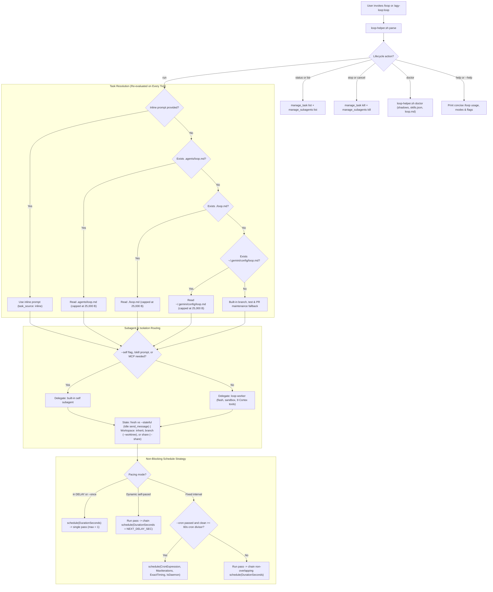

# `agy-loop` Technical Architecture

`agy-loop` implements a non-blocking, context-isolated `/loop` scheduler for **Google Antigravity CLI (`agy`)** and **Antigravity Desktop**. Rather than blocking an interactive turn with shell `sleep` or running noisy polling commands inside the primary conversation window, `agy-loop` splits scheduling, deterministic argument/file resolution, and single-pass task execution across crisp capability boundaries.

---

## 1. Repository Layout & Four-Component Design

```text
agy-loop/
├── plugin.json                              # Strict Antigravity v1 plugin manifest (additionalProperties: false)
├── package.json                             # Zero-dependency npm CLI bridge manifest (Node >= 18 ESM)
├── bin/
│   └── agy-loop.mjs                         # npm <-> `agy plugin` installer, shadow cleaner & doctor CLI
├── agents/
│   └── loop-worker.md                       # Isolated single-pass subagent (flash, sandbox, 9 Cortex tools)
├── skills/
│   └── loop/
│       ├── SKILL.md                         # Session orchestrator skill (/loop & /agy-loop:loop, < 24 KB)
│       ├── scripts/
│       │   └── loop-helper.sh               # Pure POSIX sh parser, loop.md resolver & doctor (0755)
│       └── references/
│           └── examples-and-loop-md.md      # Progressive-disclosure recipes, templates & TUI controls
├── assets/
│   └── logo.svg                             # 128x128 square Marketplace icon
├── install.sh                               # Pure POSIX one-line installer (GitHub or local checkout)
├── uninstall.sh                             # Pure POSIX clean uninstaller
└── tests/
    └── plugin.test.mjs                      # Isolated HOME unit, contract & strict-validator test suite
```

### Separation of Responsibilities

1. **Layer 1: Session Orchestrator (`skills/loop/SKILL.md`)**
   - Activated in the primary session when the user runs `/loop` or `/agy-loop:loop` (or clicks one of the 3 `suggestedPrompts` chips in Antigravity Desktop).
   - Owns **control flow only**: normalizing arguments via `loop-helper.sh`, dispatching asynchronous subagents (`invoke_subagent` or `send_message`), evaluating the 4-line worker footer, printing a single `[Loop #N/Max]` summary line, scheduling the next wake-up via `schedule`, and cancelling finished schedules via `manage_task`.
   - Keeps its Markdown body well below Antigravity's `24,000`-byte `SKILL.md` truncation ceiling by offloading extended templates and TUI guides to `skills/loop/references/examples-and-loop-md.md`.
2. **Layer 2: Isolated Iteration Worker (`agents/loop-worker.md` & `self`)**
   - Executes inside a clean subagent context window (`subagent: true`, `mainAgent: false`, `model: flash`, `commandExecutionPolicy: sandbox`).
   - Enforces **Single-Pass Discipline**: runs exactly one check, build, test, or fix+verify pass per wake-up, never calls `sleep` or `watch`, and returns a structured 4-line plain-text footer.
   - Automatically delegates to the built-in full-capability **`self`** subagent instead of `loop-worker` whenever `--self` is passed, when the inline prompt starts with `/` (invoking a nested slash skill such as `/code-review`), or when MCP server tools are required.
3. **Deterministic POSIX Control Plane (`skills/loop/scripts/loop-helper.sh`)**
   - Pure `#!/bin/sh` (`set -eu`, `0755`, zero Node/Python runtime dependencies) invoked by the orchestrator so interval math, flag validation, cron eligibility checks, JSON escaping, `loop.md` precedence lookup, and shadow diagnostics behave identically across models and OSes.
4. **Dual-Habitat Distribution Shell (`plugin.json` + `bin/agy-loop.mjs` + `install.sh`)**
   - Because `agy plugin install <name>` resolves names against the Antigravity Marketplace rather than the npm registry, `agy-loop` packages the repository root simultaneously as a native Antigravity v1 plugin (`agy plugin install https://github.com/maxlee/agy-loop`) and a zero-dependency npm CLI bridge (`npx agy-loop`) that delegates to `agy plugin install <pluginRoot>` while guarding against user-level precedence shadows.

---

## 2. Three-Turn Reactive Non-Blocking Loop Lifecycle

In Antigravity, both `invoke_subagent` and `schedule` are **asynchronous background primitives**. Ending the orchestrator's turn immediately after calling either tool parks the session at **zero token cost** and leaves the main prompt completely free for normal user conversation until a reactive wake-up arrives.

```mermaid
sequenceDiagram
  actor User
  participant Main as Main Session (loop SKILL.md)
  participant Helper as POSIX Helper (loop-helper.sh)
  participant Worker as Subagent (loop-worker / self)
  participant Sched as Native Scheduler (schedule / manage_task)

  rect rgb(15, 23, 42)
  Note over User,Sched: Turn 1 - Non-Blocking Dispatch Turn
  User->>Main: /loop check PR CI and fix failures --stateful
  Main->>Helper: sh scripts/loop-helper.sh parse ...
  Helper-->>Main: JSON spec (pacing=dynamic, state_mode=stateful, max=20)
  Main->>Worker: invoke_subagent (Iteration 1/20, clean context)
  Main-->>User: Dispatched Loop #1/20 - Yield turn immediately
  end

  par Worker executes single pass in isolated context
    Worker->>Worker: Run check / apply minimal fix / verify once
  and Main chat remains unlocked at zero polling cost
    User->>Main: Normal unrelated coding question
    Main-->>User: Immediate response (zero build/CI log noise)
  end

  rect rgb(15, 23, 42)
  Note over User,Sched: Turn 2 - Reactive Subagent Wake-up Turn
  Worker-->>Main: Completion message + 4-line contract (CONTINUE, 45s)
  alt LOOP_STATUS == CONTINUE and iteration < max_iterations
    Main->>Sched: schedule(DurationSeconds=45, state-carrying Prompt)
    Sched-->>Main: Scheduled TaskId
    Main-->>User: [Loop #1/20] SUMMARY | Next wake-up in 45s - Yield turn
  else LOOP_STATUS == DONE or BLOCKED or iteration == max_iterations
    Main->>Sched: manage_task(Action="kill", TaskId) if active cron/timer exists
    Main-->>User: Final summary & clean stop
  end
  end

  Note over Sched: Background timer sleeps at 0 tokens/sec (User can keep chatting)

  rect rgb(15, 23, 42)
  Note over User,Sched: Turn 3 - Timer Wake-up Turn (Repeats Turn 2 -> Turn 3)
  Sched-->>Main: High-priority wake-up Prompt (Iteration 2/20, NEXT_HINT, worker_id)
  Main->>Helper: resolve-task (re-reads loop.md when task_source != inline)
  Main->>Worker: send_message to Idle worker_id (or invoke_subagent if fresh)
  Main-->>User: Yield turn immediately
  end
```



*(For one-shot invocations such as `/loop in 20m <task>` or `/loop --once 10m <task>`, Turn 1 schedules `DurationSeconds` directly with `max_iterations = 1` before dispatching the single subagent pass when the timer fires.)*

---

## 3. Task, Subagent & Pacing Resolution Flow



### Why Chained `DurationSeconds` Is the Default Over Raw Cron

Even when a fixed interval is `>= 60s` (for example `/loop 5m run integration suite`), `loop-helper.sh` computes `cron_expr` (`*/5 * * * *`) but keeps `use_cron: false` unless `--cron` is explicitly passed:

1. **Zero Overlapping Runs**: Chaining a one-shot `schedule(DurationSeconds=...)` *after* the subagent finishes guarantees Iteration `N+1` never starts while Iteration `N` is still compiling or running tests.
2. **Sub-Minute & Non-Divisor Precision**: `DurationSeconds` handles `15s`, `30s`, `45s`, `90s`, or `7m` natively without rounding to 5-field cron boundaries.
3. **Opt-In Wall-Clock Cron (`--cron`)**: When wall-clock cadence is desired (`1m` -> `* * * * *`, `Nm` dividing `60` -> `*/N * * * *`, `60m`/`1h` -> `0 * * * *`, `Nh` dividing `24` -> `0 */N * * *`, `24h`/`1d` -> `0 0 * * *`), `--cron` enables `CronExpression` with optional `--exact` (`ExactTiming: true`) and `--daemon` (`IsDaemon: true`).

---

## 4. Worker-to-Orchestrator Output Contract & State Carrier

### 4-Line Plain-Text Footer Contract

Every `loop-worker` (or loop-delegated `self`) execution ends with four plain-text key-value lines **without surrounding Markdown code fences**:

```text
LOOP_STATUS: DONE | CONTINUE | BLOCKED
NEXT_DELAY_SEC: <integer seconds>
SUMMARY: <concise 1-line summary of current state and actions taken>
NEXT_HINT: <brief context or focus point for the next iteration, or None>
```

- **Why Fence-Free Plain Text**: Early prototypes wrapped the footer in nested triple-backtick blocks inside `SKILL.md` / agent prompts, which broke Markdown block boundaries and brittle parsers whenever summaries contained backticks. Key-anchored plain text at the tail of the worker message parses reliably in every turn.
- **Adaptive `NEXT_DELAY_SEC` Bands**:
  - `30` to `60`: Active local build, imminent job completion, or verifying a freshly pushed fix.
  - `120` to `300`: Normal polling while waiting on external CI/deployment queues.
  - `600` to `1800`: Everything green and quiet during background branch tending.

### Stateless-Safe Wake-Up `Prompt` Carrier

Because long sessions may undergo context compaction (`/compact` or automatic watermark compaction) while a loop runs over hours, the orchestrator embeds compact loop metadata directly inside each `schedule` wake-up `Prompt`:

- `iteration` (`N+1`) and `max_iterations`
- `pacing`, `interval_sec`, and `cron_task_id` (so an active `--cron` job can always be killed via `manage_task` upon `DONE` or `BLOCKED`)
- `state_mode`, `worker_id` (for `--stateful` `send_message` re-awakening), `workspace`, `delegate`, and `model`
- `task_source` (`inline` prompt text vs `loop_md_or_default` trigger to re-run `loop-helper.sh resolve-task`)
- `NEXT_HINT` from Iteration `N`

---

## 5. Customization Precedence & Shadowing Model

Antigravity discovers skills and subagents in strict precedence order (highest to lowest):

1. **Workspace Project** (`.agents/`, `.agent/`, `_agents/`, `_agent/` walking up to repository root)
2. **Workspace Declared JSON** (`.agents/skills.json`, `.agents/plugins.json`)
3. **Global User Discovery** (`~/.gemini/config/skills/`, `~/.gemini/config/agents/`, plus CLI-specific `~/.gemini/antigravity-cli/skills/` and `~/.gemini/skills/`)
4. **Built-in Customizations** (`~/.gemini/antigravity-cli/builtin/`)
5. **Installed Plugins & Global Declared JSON** (`~/.gemini/config/plugins/agy-loop/`)

### Guardrails Against Silent Discovery Failures

- **Shadow Detection & Non-Destructive Backup**: If a user previously created loose files at `~/.gemini/config/skills/loop`, `~/.gemini/config/agents/loop-worker.md`, `~/.gemini/antigravity-cli/skills/loop`, or `~/.gemini/skills/loop`, Tier 3 silently overrides Tier 5 (`agy-loop`). Both `npx agy-loop` and `install.sh` warn on detection and, when `--clean-shadow` is passed, move those files into a timestamped backup directory (`~/.gemini/config/.agy-loop-backup-<timestamp>/`) rather than deleting user files destructively.
- **`skills.json` Allowlist Audit**: Both `loop-helper.sh doctor` and `npx agy-loop doctor` inspect workspace `.agents/skills.json` and global `~/.gemini/config/skills.json` for `"include_only"` arrays that omit `"loop"`.
- **Strict v1 Native Plugin Layout**: Antigravity's native plugin loader ignores `commands/`, root `AGENTS.md`, and `hooks/hooks.json`, and skips any `SKILL.md` with unquoted YAML special characters (`"<task>"`, `[--max N]`). `agy-loop` exposes `/loop` exclusively through `skills/loop/SKILL.md` with quoted YAML strings and validates cleanly with `0` warnings and `0` notes under `agy plugin validate --strict .`.

---

## 6. Subagent Tool Allowlist, Sandbox & Worktree Safety

1. **Verified Internal Cortex Tool Allowlist (Anti-Hang & Least Privilege)**
   - In Antigravity plugins, omitting `tools:` in `agents/<name>.md` restricts a plugin subagent to read-only defaults (no shell or file-edit capability), while listing an unmapped or misspelled tool name can cause the subagent process to hang on startup.
   - `agents/loop-worker.md` pins the exact 9 verified internal Cortex tools required for inspection, editing, and verification (`send_message` is injected automatically):
     `view_file`, `write_to_file`, `replace_file_content`, `multi_replace_file_content`, `list_dir`, `find_by_name`, `grep_search`, `run_command`, and `manage_task`.
   - Note that `loop-worker` is intentionally **not** granted `schedule` or `invoke_subagent`, making recursive self-scheduling or runaway subagent fan-out structurally impossible inside `loop-worker`.
2. **CLI Roster Hygiene (`mainAgent: false`)**
   - Setting `subagent: true` and `mainAgent: false` keeps `loop-worker` available to `invoke_subagent` and visible inside `/agents` when active, without cluttering `agy agents` or `agy --agent <name>` primary session selectors.
3. **Sandbox Execution (`commandExecutionPolicy: sandbox`)**
   - Shell commands executed by `loop-worker` run under Antigravity's OS sandbox policy by default while inheriting parent workspace approvals (with interactive `Ctrl+K` fast-path approval and `Alt+J` live transcript teleport in `agy` CLI).
4. **Git Worktree Isolation (`--worktree` -> `Workspace: "branch"`)**
   - Passing `--worktree` spawns the worker inside an isolated Git branch worktree rather than the user's active checkout (`inherit`). Experimental refactors or multi-step fixes never dirty uncommitted edits in the main terminal; verified commits or diffs can be merged cleanly once `DONE`, and killing the subagent (`manage_subagents` or `/agents` + `k`) automatically cleans up temporary worktree state.
5. **Bounded File & Quota Safeguards**
   - `loop-helper.sh resolve-task` caps `loop.md` reads at `25,000` bytes (`truncated: true` metadata flag) so an accidentally huge Markdown file cannot blow up worker context, and `--max 20` enforces a default iteration circuit breaker against unattended quota burn.
