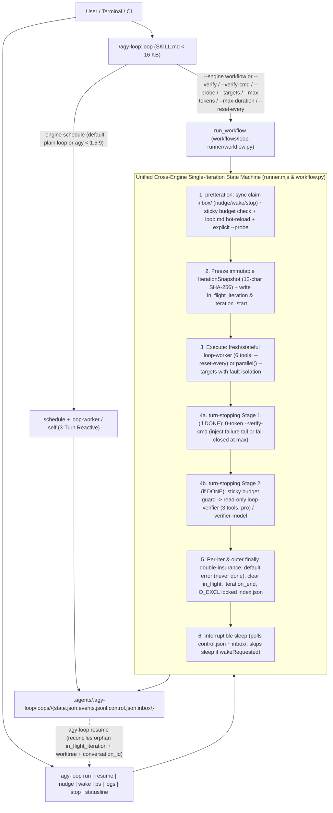
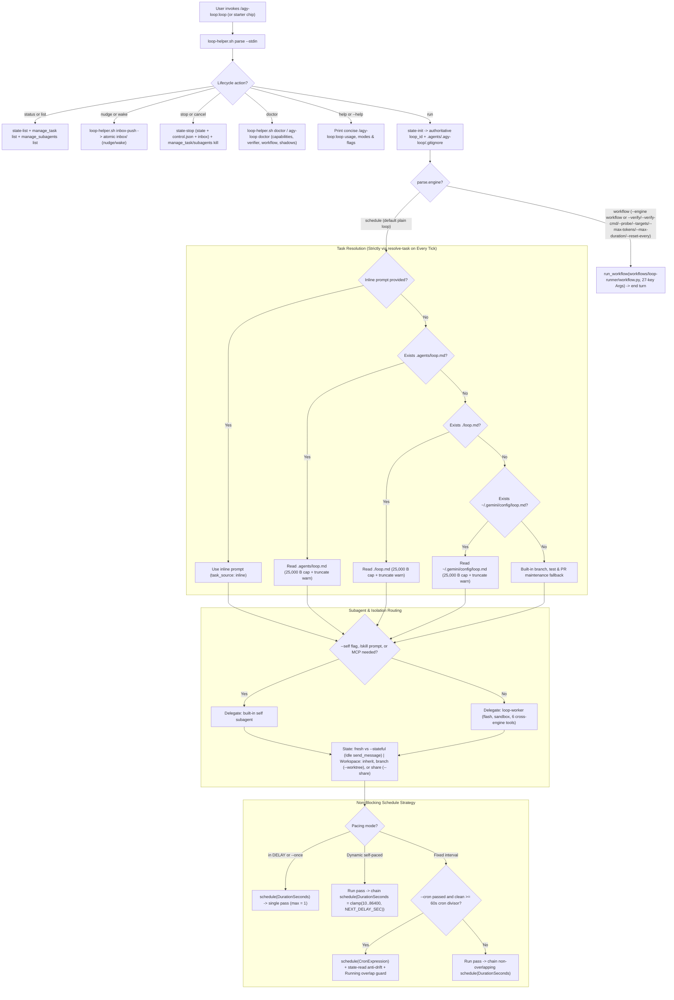
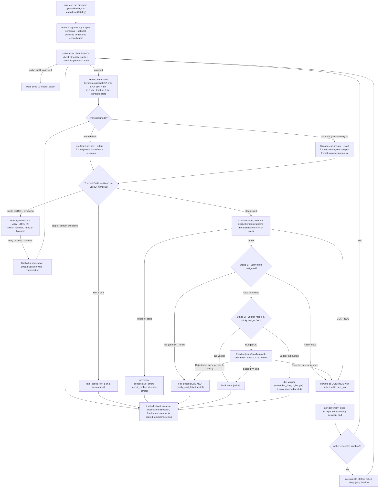

# `agy-loop` Technical Architecture

`agy-loop` (`v1.3.0`) implements a dual-engine, Marketplace-compatible non-blocking `/agy-loop:loop` scheduler (**`schedule` reactive timers** + **`run_workflow` dynamic Python engine** for `agy >= 1.5.9`), an independent read-only `loop-verifier` subagent, and a zero-dependency **Headless CLI Runner** (`agy-loop run | resume | nudge | wake | ps | logs | stop | statusline`) for **Google Antigravity Desktop** and **Antigravity CLI (`agy`)**. Rather than locking an interactive turn with shell `sleep` or dumping noisy logs into the primary conversation window, `agy-loop` splits scheduling, deterministic argument/state resolution, worker execution, and two-stage verification across crisp capability boundaries — sharing a unified, sandbox-safe per-loop state store under `<workspace>/.agents/.agy-loop/` (automatically `.gitignore`d) across all engines.

---

## 1. Repository Layout & Component Overview

```text
agy-loop/
├── plugin.json                              # Strict Antigravity v1 plugin manifest (additionalProperties: false)
├── hooks.json                               # SessionStart shadow & skills.json filter detector (0 tokens when clean)
├── package.json                             # Zero-dependency npm CLI bridge & headless runner manifest (Node >= 18 ESM)
├── bin/
│   └── agy-loop.mjs                         # npm <-> `agy plugin` installer, shadow cleaner, doctor & v1.3 CLI router
├── lib/
│   ├── duration.mjs                         # Single/compound duration parser, Go duration & compact token formatters
│   ├── parse-run-args.mjs                   # `agy-loop run` CLI flag & interval parser (incl. --verify-cmd/--verify-timeout)
│   ├── schemas.mjs                          # Iteration & verifier JSON Schemas, prompt builders (nudges, Stage 1 summary) & outcome guards
│   ├── error-policy.mjs                     # AGY_ERROR parser, failure classifier, backoff & usage delta/budgets
│   ├── models.mjs                           # `agy models` catalog parser, slug/label resolver & Orchestrator check
│   ├── state-store.mjs                      # Unified .agents/.agy-loop/ store, inbox/ queue, O_EXCL locked index.json & loop.md resolver
│   ├── worktree.mjs                         # Headless Git worktree creation, inspection & cleanup/merge hints
│   ├── json-client.mjs                      # Single-turn `agy --output-format json ... -p` transport client
│   ├── stream-client.mjs                    # Persistent bidirectional `stream-json` NDJSON `StreamSession`
│   ├── runner.mjs                           # Headless loop state machine, preIteration snapshot, two-stage gate & resume
│   └── cli-commands.mjs                     # `run`, `resume`, `nudge`, `wake`, `ps`/`list`, `logs`, `stop`, and `<5ms` `statusline`
├── agents/
│   ├── loop-worker.md                       # Isolated single-pass worker subagent (flash, sandbox, 6 cross-engine tools)
│   └── loop-verifier.md                     # Independent read-only verifier subagent (pro, sandbox, 3 read-only tools)
├── workflows/
│   └── loop-runner/                         # Zero-.md dynamic Python workflow bundle (agy >= 1.5.9 run_workflow)
│       ├── workflow.json                    # Strict 27-property `args` JSON Schema (additionalProperties: false)
│       └── workflow.py                      # Single-file Python 3.8+ stdlib runner (parallel targets, two-stage gate, inbox, budgets)
├── skills/
│   └── loop/
│       ├── SKILL.md                         # Session orchestrator skill (/agy-loop:loop, < 16 KB target / < 24 KB cap)
│       ├── scripts/
│       │   └── loop-helper.sh               # Pure POSIX sh parser, engine router, inbox-push, state-*, loop.md resolver, hook & doctor (0755)
│       └── references/
│           ├── workflow-engine.md           # Progressive-disclosure run_workflow Args mapping, fallback, verify & targets guide
│           └── examples-and-loop-md.md      # Progressive-disclosure templates, nudge/wake recipes & TUI controls
├── assets/
│   └── logo.svg                             # 128x128 square Marketplace icon
├── install.sh                               # Pure POSIX one-line & in-place (--clean-shadow) installer (UTC backups)
├── uninstall.sh                             # Pure POSIX clean uninstaller
└── tests/
    ├── plugin.test.mjs                      # Isolated HOME unit, contract, hook, doctor & strict-validator test suite
    ├── workflow.test.mjs                    # Workflow JSON schema & mock-runtime Python state-machine suite
    ├── headless.test.mjs                    # Mock-agy dual-transport, inbox, snapshot, two-stage gate, resume & CLI suite
    └── live.test.mjs                        # Opt-in live `agy` CLI integration suite (AGY_LIVE_TEST=1)
```

### High-Level Architecture & Unified Cross-Engine Single-Iteration State Machine



### Component Overview & Separation of Responsibilities

1. **Layer 1: Session Orchestrator (`skills/loop/SKILL.md`)**
   - Activated in the primary session when the user invokes `/agy-loop:loop` (or clicks one of the 3 `suggestedPrompts` chips in Antigravity Desktop).
   - Keeps its Markdown body under **`16,000` bytes** (`14,358` bytes total / `14,033` bytes body, well below Antigravity's `24,000`-byte `SKILL.md` truncation ceiling) by offloading `run_workflow` details to `references/workflow-engine.md` and extended recipes/TUI guides to `references/examples-and-loop-md.md`.
   - Routes Phase 0 lifecycle actions (`status`, `stop`, `nudge`, `wake`, `doctor`, `help`) and initializes authoritative state (`state-init`) before branching on `parse.engine` (`workflow` via `run_workflow` vs `schedule` via 3-Turn Reactive Protocol).
2. **Layer 2: Isolated Workers & Read-Only Verifier (`agents/loop-worker.md`, `agents/loop-verifier.md`, `self`)**
   - `loop-worker` (`subagent: true`, `mainAgent: false`, `model: flash`, `commandExecutionPolicy: sandbox`) pins the **6-tool cross-engine intersection** (`view_file`, `write_to_file`, `replace_file_content`, `run_command`, `manage_task`, `search_web`).
   - `loop-verifier` (`subagent: true`, `mainAgent: false`, `model: pro`, `commandExecutionPolicy: sandbox`) enforces a **strict 3-tool read-only subset** (`view_file`, `run_command`, `search_web`), physically removing write tools and scheduling primitives, and returns fail-closed `{ passed, summary, issues }`.
   - Built-in **`self`** subagent is selected whenever `--self` is passed, when the prompt starts with `/`, or when MCP/browser tools are needed.
3. **Layer 3: Dynamic Python Workflow Engine (`workflows/loop-runner/`)**
   - `workflow.json` validates 27 typed/nullable arguments (`additionalProperties: false`, `required: ["workspace_dir"]`) before `agy >= 1.5.9` starts `workflow.py`.
   - `workflow.py` (Python 3.8+ stdlib, zero external dependencies, zero `.md` files in `workflows/`) drives the entire multi-turn loop asynchronously in the background, reducing a 20-iteration interactive loop from ~41 main-chat turns down to **2 turns (~95% fewer main-chat turns)**.
4. **Layer 4: Deterministic POSIX Control Plane (`skills/loop/scripts/loop-helper.sh`)**
   - Pure `#!/bin/sh` + `POSIXLY_CORRECT=1 LC_ALL=C awk` (`0755`, zero Node/Python dependencies) providing `parse` (with `workflow` flags, `nudge`/`wake` subcommands, conflict checks, and engine routing), `inbox-push` (atomic `inbox/` queueing for interactive `nudge`/`wake`), `state-init`/`state-read`/`state-update`/`state-list`/`state-stop` (preserving extra `workflow`/`headless` fields and dual-writing `control.json` + `inbox/` on stop), `resolve-task` (`25,000`-byte UTF-8 cap), `session-start`, and `doctor`.
5. **Layer 5: Zero-Overhead `SessionStart` Guard & Dual-Habitat Shell (`hooks.json`, `bin/agy-loop.mjs`)**
   - `hooks.json` emits `{}` in `<5ms` (`0` tokens, strictly `protojson`-compliant for `agy v1.5.13+`) when clean, or `{ "injectSteps": [...] }` on shadows / `skills.json` filters.
   - `bin/agy-loop.mjs` handles `install`, `uninstall`, `validate`, `doctor` (extended with `verifierToolsCheck` and `workflowBundleCheck`), and routes `run | resume | nudge | wake | ps | list | logs | stop | statusline`.
6. **Layer 6: Headless Runner & State Consistency (`lib/*.mjs`)**
   - Zero-dependency `Node >= 18` ESM layer powering `agy-loop run`, `resume`, `nudge`, `wake`, `ps`/`list`, `logs`, `stop`, and `<5ms` `statusline` with unified `inbox/`, `O_EXCL`-locked `index.json`, frozen `IterationSnapshot`, two-stage `turn-stopping` gate, sticky budgets, and `finally` double-insurance.

---

## 2. Three-Turn Reactive Non-Blocking Loop Lifecycle (`schedule` Engine)

When `parse.engine == "schedule"` (plain `/agy-loop:loop` or explicit `--engine schedule`), both `invoke_subagent` and `schedule` are **asynchronous background primitives**. Ending the orchestrator's turn immediately after calling either tool parks the session at **zero token cost** and leaves the main prompt free until a reactive wake-up arrives.


*(For one-shot invocations such as `/agy-loop:loop in 20m <task>` or `/agy-loop:loop --once 10m <task>`, Turn A creates `state.json`, schedules `DurationSeconds` directly with `max_iterations = 1`, records `task_id`, and dispatches the single subagent pass when the timer fires.)*

---

## 3. Task, Engine, Subagent & Pacing Resolution Flow



### Why Chained `DurationSeconds` Is the Default Over Raw Cron

Even when a fixed interval is `>= 60s` (for example `/agy-loop:loop 5m run integration suite` or `/agy-loop:loop every 2m30s check build`), `loop-helper.sh` computes `cron_expr` (`*/5 * * * *`) when cleanly mappable but keeps `use_cron: false` unless `--cron` is explicitly passed:

1. **Zero Overlapping Runs**: Chaining a one-shot `schedule(DurationSeconds=...)` *after* the subagent finishes guarantees Iteration `N+1` never starts while Iteration `N` is still compiling or running tests.
2. **Sub-Minute, Compound & Non-Divisor Precision**: `DurationSeconds` handles `15s`, `30s`, `2m30s`, `1h30m`, or `7m` natively without rounding to 5-field cron boundaries (fractional inputs like `1.5m` fail fast with Exit `2` suggesting `90s` / `1m30s`).
3. **Opt-In Wall-Clock Cron (`--cron`)**: When wall-clock cadence is desired (`1m` -> `* * * * *`, `Nm` dividing `60` -> `*/N * * * *`, `60m`/`1h` -> `0 * * * *`, `Nh` dividing `24` -> `0 */N * * *`, `24h`/`1d` -> `0 0 * * *`), `--cron` enables `CronExpression` with optional `--exact` (`ExactTiming: true`) and `--daemon` (`IsDaemon: true`). Turn C reads `iteration`, `next_hint`, `worker_id`, and `stop_requested` from `.agents/.agy-loop/loops/<loop_id>/state.json` via `state-read`, completely eliminating static cron prompt drift.

---

## 4. Worker Output Contract, Circuit Breaker & Externalized State Store

### 4-Line Plain-Text Footer Contract, Delay Clamp & Circuit Breaker

In `schedule` mode (and as a fallback parser in headless `json` mode), `loop-worker` (or loop-delegated `self`) ends with four plain-text key-value lines **without surrounding Markdown code fences**:

```text
LOOP_STATUS: DONE | CONTINUE | BLOCKED
NEXT_DELAY_SEC: <integer seconds>
SUMMARY: <concise 1-line summary of current state and actions taken>
NEXT_HINT: <brief context or focus point for the next iteration, or None>
```

- **Why Fence-Free Plain Text**: Key-anchored plain text at the tail of the worker message avoids nested Markdown fence breakages whenever summaries contain backticks.
- **Delay Validation & Clamping (`[10, 86400]`)**: Delays default to `120s` if missing, non-integer, or negative, and clamp dynamic self-paced intervals to `min(86400, max(10, NEXT_DELAY_SEC))`.
- **3-Error Consecutive Circuit Breaker**: Missing/invalid outcomes or unrecoverable errors increment `consecutive_errors` in `state.json` (resetting to `0` on valid passes). Reaching `consecutive_errors >= 3` (`--max-errors`) marks `status: "circuit_broken"`, cancels active schedules, and stops cleanly with diagnostics.

### Sandbox-Safe Unified Control Plane (`.agents/.agy-loop/`) & Locked `index.json`

In `agy v1.5.7+` default `auto` mode, OS-sandboxed `run_command` grants write access only to workspace roots, `ArtifactDirectoryPath`, and OS temp/caches — blocking writes to `~/.gemini/antigravity-cli/plugin_data/`. To guarantee zero sandbox denials while uniting `schedule`, `workflow`, and `headless` runs:

- **Workspace-Scoped Isolation**: All three engines store per-loop state under `${AGY_LOOP_STATE_DIR:-<workspace>/.agents/.agy-loop}/loops/<loop_id>/` (`state.json`, append-only `events.jsonl`, `control.json`, and `inbox/`) using UTC + random hex IDs (`lp_YYYYMMDDTHHMMSSZ_<4hex>`, validated against `^lp_[A-Za-z0-9_-]{4,64}$`).
- **Zero Git Pollution**: `state-init`, `ensureStateRoot`, and `ensure_state_root` atomically create `*` in `<state_root>/.gitignore` via `wx` / `O_EXCL` so neither `git status` nor `agy v1.5.5+` dirty-file worktrees pick up runtime state files.
- **Atomic `inbox/` Control Queue (`nudge` / `wake` / `stop`)**:
  - Writers (`enqueueInboxMessage` in Node, `inbox-push` / `state-stop` in `loop-helper.sh`) write JSON records to a temp file and atomically rename into `<loop_dir>/inbox/<epoch>_<pid>_<hex>.json`.
  - `peekInboxFlags` / `peek_inbox_flags` scans pending `inbox/*.json` non-destructively during inter-iteration sleep or post-turn checks (`wakeRequested`).
  - `claimInboxMessages` / `claim_inbox_messages` reads sorted `inbox/*.json` at `preIteration`, atomically renames each into `inbox/claimed/` (pruning retention to the latest 100 files) so every message is delivered at most once without write-write races.
  - `writeControlStop` dual-writes `control.json` and an `inbox/` `stop` message; `clearControlStop` cleans both before `resume`.
- **Cross-Process `O_EXCL`-Locked Global Index (`index.json`)**:
  - Non-isolated `workflow` and `headless` runs upsert into `~/.gemini/antigravity-cli/plugin_data/agy-loop/index.json` (200-entry cap, `AGY_LOOP_INDEX_PATH` override; automatically bypassed when `AGY_LOOP_STATE_DIR` / `state_dir` isolates tests).
  - Both `lib/state-store.mjs` (`withFileLock`) and `workflows/loop-runner/workflow.py` (`with_file_lock`) share the exact same `${indexPath}.lock` `O_EXCL` lock protocol (`{ pid, acquired_at }`), reclaiming locks whose holder PID is dead (`isPidAlive` / `is_pid_alive`) or whose `mtime` exceeds `10s` (`staleMs = 10000` / `stale_sec = 10.0`), with jittered backoff.

---

## 5. Customization Precedence, Shadowing & `doctor` Diagnostics

Antigravity discovers skills and subagents in strict precedence order (highest to lowest):

1. **Workspace Project** (`.agents/`, `.agent/`, `_agents/`, `_agent/` walking up to repository root)
2. **Workspace Declared JSON** (`.agents/skills.json`, `.agents/plugins.json`)
3. **Global User Discovery** (`~/.gemini/config/skills/`, `~/.gemini/config/agents/`, plus CLI-specific `~/.gemini/antigravity-cli/skills/` and `~/.gemini/skills/`)
4. **Built-in Customizations** (`~/.gemini/antigravity-cli/builtin/`)
5. **Installed Plugins & Global Declared JSON** (`~/.gemini/config/plugins/agy-loop/`)

### Guardrails Against Silent Discovery & Runtime Failures

- **Pure Plugin Namespacing (`/agy-loop:loop`)**: Registers consistently across Desktop Marketplace and CLI (`agy`) without scattering files into `~/.gemini/config/`.
- **Strict `protojson` `SessionStart` Hook (`hooks.json`)**: Under `agy v1.5.13+` (verified on `v1.5.14`), plugin hooks use strict `protojson` unmarshaling and reject echoed stdin fields (such as `artifactDirectoryPath`). `loop-helper.sh session-start` emits `{}` (`0` tokens, `<5ms`) when clean, or strictly `{ "injectSteps": [...] }` when Tier 3 shadow files or `skills.json` `include_only`/`exclude` filters (matched with POSIX ERE parity against `bin/agy-loop.mjs`) block `/agy-loop:loop`.
- **Unified UTC `--clean-shadow` Archiving**: `bin/agy-loop.mjs`, `loop-helper.sh`, and `install.sh` all archive colliding Tier 3 files into `~/.gemini/config/.agy-loop-backup-YYYYMMDD-HHMMSSZ/` with cross-filesystem fallback.
- **Upgraded `doctor` Diagnostics (`npx agy-loop doctor [--json]`)**:
  - **`agy.capabilities`**: Parses `agy --version` into a version capability matrix (`printTimeout`, `sidecarHomeExpansion`, `worktreeDirtyCarry`, `autoModeDefault`, `dynamicWorkflows`, `githubUrlValidate`, `strictProtojsonHooks`).
  - **Enterprise & Policy Audit (`environment`, `environmentWarnings`)**: Non-secret read-only inspection of `~/.gemini/config/admin_settings.json`, `~/.gemini/antigravity-cli/settings.json`, and static `hooks.json` matcher structures (`PreToolUse`/`PostToolUse` grouping).
  - **Agent, Workflow & Hook Self-Tests**:
    - `hookSelfTest`: runs `SessionStart` against synthetic `v1.5.14` `artifactDirectoryPath` stdin checking zero leaked keys.
    - `agentToolsCheck`: validates `agents/loop-worker.md` `model` tier and 6-tool cross-engine compatibility.
    - `verifierToolsCheck`: validates `agents/loop-verifier.md` `model` tier and strictly read-only dual-engine tool subset (asserting zero `write_to_file` / `replace_file_content`).
    - `workflowBundleCheck`: validates `workflows/loop-runner/workflow.json` (`entry` path containment & existence, `args.type === "object"`), `workflow.py` presence, and zero `.md` files under `workflows/`.
    - `activeLoops`: lists live loops across `interactive`, `workflow`, and `headless` engines with PID-based `stale` detection alongside `active_loops` in `loop-helper.sh doctor`.
- **Strict v1 Native Plugin Layout**: Root `plugin.json`, root `hooks.json`, `skills/*/SKILL.md` (safely quoted YAML frontmatter), and `agents/*.md` validate with `0` findings (`components: { agents: 2, hooks: 1, skills: 1 }`, `findings: []`) under `agy v1.5.14` `agy plugin validate --strict --json .`.

---

## 6. Subagent Dual-Engine Tool Split, Sandbox & Worktree Safety

1. **Exact Dual-Engine Tool Split (`loop-worker`: 6 Tools vs `loop-verifier`: 3 Read-Only Tools)**
   - In `agy v1.5.13+` (verified on `v1.5.14`), CLI `oneharness` (`DeclarativeConfigLoader.Load` / `ConstructFromRegistry`) treats unmapped tool names in `agents/*.md` as a **fatal component-load error** (`not found in registry`), whereas Desktop Cortex registers legacy tool identifiers (`view_file`, `write_to_file`, `replace_file_content`), which `oneharness` forward-canonicalizes (`view_file -> read_file`, `write_to_file -> write_file`, `replace_file_content -> edit_file`).
   - **`agents/loop-worker.md` (`model: flash`, `commandExecutionPolicy: sandbox`)** pins the **6-tool cross-engine verified intersection**:
     `view_file`, `write_to_file`, `replace_file_content`, `run_command`, `manage_task`, and `search_web` (`send_message` is injected automatically). The 4 legacy Cortex-only tools (`multi_replace_file_content`, `list_dir`, `find_by_name`, `grep_search`) stay removed; directory listing and code search run cleanly via sandboxed `run_command` (`rg`, `grep`, `find`, `ls`).
   - **`agents/loop-verifier.md` (`model: pro`, `commandExecutionPolicy: sandbox`)** pins the **strictly read-only 3-tool subset**:
     `view_file`, `run_command`, and `search_web`. Write tools (`write_to_file`, `replace_file_content`) and scheduling/delegation tools (`manage_task`, `schedule`, `invoke_subagent`) are physically excluded.
2. **CLI Roster Hygiene (`mainAgent: false`)**
   - Keeps both `loop-worker` and `loop-verifier` scoped to orchestrators and `/agents` without cluttering `agy agents` or `agy --agent <name>` primary session selectors.
3. **Sandbox Execution & Prompt-Injection Defense**
   - Shell commands inside subagents run under Antigravity's OS sandbox (`commandExecutionPolicy: sandbox`). Both `loop-worker` and `loop-verifier` treat repository text, diffs, build logs, probe output, and web search results as untrusted data.
4. **Git Worktree Isolation & Preservation (`--worktree` -> `Workspace: "branch"`, `v1.5.5+`)**
   - In `agy v1.5.5+`, `Workspace: "branch"` worktrees inherit staged, unstaged, and untracked changes from the parent checkout. `loop-worker` distinguishes pre-existing dirty files from its own verified edits and commits fixes locally without pushing.
   - `SKILL.md` records `worktree_branch` in `state.json`, surfaces branch name, `git diff --stat`, and `git cherry-pick` / `git merge` commands before teardown, and keeps the `branch` subagent `Idle` if unmerged commits await review.
5. **Bounded File & Quota Safeguards**
   - `loop-helper.sh resolve-task` / `resolveLoopMdTask` / `resolve_loop_md_task` enforce a `25,000`-byte UTF-8-safe cap, `--max 20` caps default iterations, and the 3-error circuit breaker halts stuck loops automatically.

---

## 7. Headless Dual-Transport & State Consistency Architecture (`v1.3`)

`agy-loop` extends the interactive scheduler into a deterministic, zero-dependency headless CLI runner (`agy-loop run | resume | nudge | wake | ps | logs | stop | statusline`) verified against **`agy v1.5.14`**, sharing the same `.agents/loop.md` precedence rules and `.agents/.agy-loop/` control plane.



### 7.1 Dual-Transport Execution (`fresh` vs `--stateful`)

1. **`fresh` Single-Turn JSON Transport (`lib/json-client.mjs`)**:
   - Invokes `agy --output-format json --json-schema <iter-schema.json> --print-timeout <dur> [flags] -p "<prompt>"` per iteration with **all CLI flags strictly preceding `["-p", prompt]`**.
   - Avoids `--agent loop-worker` (which exits `1` in `-p` mode because `mainAgent: false`) and instead carries the single-pass discipline directly in `buildWorkerPrompt` + `ITERATION_RESULT_SCHEMA`.
   - Uses string-aware outermost brace scanning (`parseJsonEnvelope`), paired with an outer safety watchdog (`turnTimeoutSec + 60s`) and `AbortSignal` termination (`SIGTERM` + 5s `SIGKILL` fallback).
2. **`--stateful` Persistent `stream-json` Transport (`lib/stream-client.mjs`)**:
   - Spawns a long-lived bidirectional NDJSON process via `agy --input-format stream-json --output-format stream-json --json-schema <iter-schema.json> [flags]` — **never passing `-p` / `--print`** (which causes `agy` Exit `2`).
   - Captures `conversation_id` on `event === "init"`, feeds turns via `{"event":"user","message":{"content":...}}`, rotates processes every `--reset-every <N>` turns (seeding `next_hint` via `formatActionableSeedHint` and logging `session_reset`), and closes gracefully via `stdin.end()`.
   - **Cumulative Usage Delta Accounting (`computeUsageDelta`)** and **Stale `structured_output` Guard (`extractIterationOutcome`)** protect per-turn telemetry and guard against stale carryover across turns (`iteration` nonce + `finish` step tracking).
   - **Automatic `--conversation` Respawn on Exit `3`**: Closes failed sessions and respawns `StreamSession` with `--conversation <saved_id>` (and `--fallback-model` when switching).
3. **Model Catalog & Minimal-Permission Flag Routing (`lib/models.mjs`, `buildAgyCommonFlags`)**:
   - Queries `agy --output-format json models`, resolves slugs or display labels with edit-distance hints (`exit 2`), omits `--effort` for `Orchestrator` models, passes `--disable-slash-commands` unless `--allow-slash-commands`, and inherits the user's configured `agy` mode unless overridden.

### 7.2 Cross-Engine State Consistency, Checkpointing & `resume` (`v1.3.0`)

- **Frozen `IterationSnapshot` & Paired Checkpoints**:
  - `runPreIteration` claims `inbox/` (`inbox_claim` event), checks stop and budgets, resolves `loop.md`, runs bounded `--probe`, and builds an `Object.freeze`d `IterationSnapshot` with a 12-char SHA-256 `snapshotHash`.
  - Before invoking the worker, `runner.mjs` sets `in_flight_iteration` + `in_flight_snapshot_hash` in `state.json` and emits `iteration_start`. A per-iteration `try / finally` unconditionally clears `in_flight_*` and writes `iteration_end` (`outcome`, `duration_ms`, `usage_delta`).
- **`finally` Double-Insurance Error Terminal State**:
  - `executeHeadlessLoop` initializes `finalStatus = "error"`, `exitReason = "unhandled_exception"`, `exitCode = EXIT_CODES.ERROR` (never `"done"`). Any unexpected exception caught by `try / catch` logs diagnostics and enters `finally` to persist `"status": "error"` safely.
- **Two-Stage `turn-stopping` Gate & Sticky Hard-Budget Guard (`runTwoStageGate`)**:
  - Stage 1 runs `--verify-cmd` (`0` LLM tokens, `60s` default timeout, `4096 B` UTF-8 tail, `verify_cmd` event). Failures short-circuit Stage 2 and inject failure details into `next_hint` (or fail closed `BLOCKED` `verify_cmd_failed` Exit `3` at `--max`/`--once`).
  - Stage 2 enforces a **sticky budget check** (`maxDurationSec`, `maxTokens`) before calling `--verifier-model`. Once exhausted, Stage 2 is skipped (`skipped_due_to_budget: true, unverified_due_to_budget: true`) and exits cleanly with `status: "max_reached"` (`exit 4`).
- **Checkpoint Recovery (`resumeHeadlessLoop` / `agy-loop resume`)**:
  - Accepts `stopped`, `max_reached`, `blocked`, `circuit_broken`, `error`, or `running` loops with dead PIDs (`[stale]`); rejects `done` or non-headless loops (`exit 2`) and live running PIDs (`exit 1`).
  - Reconciles orphan `in_flight_iteration != null` by writing an `iteration_end` (`outcome: "interrupted"`) record and resuming from that interrupted iteration.
  - Verifies and reattaches `worktree_path` / `worktree_branch` (fail-fast `exit 2` if missing), restores `savedConversationId`, `usage_totals`, `denied_actions_count`, `next_hint`, and `active_model`, clears old `control.json` / `inbox/` stops, and merges `run_config_snapshot` (explicitly stripped of `settingsArg`/`settings`).
  - **Explicit Budget Extension Guard**: When `prev.status === "max_reached"`, requires a strictly higher `--max`, `--max-tokens`, or `--max-duration` override matching the exhausted budget (otherwise fails fast with `exit 2`).

### 7.3 `AGY_ERROR` Policy, Soft-Denials, `--probe` & `--worktree`

1. **`AGY_ERROR` Parsing & Exit Codes (`lib/error-policy.mjs`)**: Exit `1`/`2` -> `fatal_config` (`0` retries); Exit `3` + quota/capacity -> `--fallback-model`; non-retryable quota -> `BLOCKED` (`exit 3`); `print_timeout`/transient -> jittered retry (`30s -> 60s -> 120s`); budgets -> `max_reached` (`exit 4`); `SIGINT`/`SIGTERM`/`stop` -> `stopped` (`exit 130`).
2. **Soft-Denial (`denied_actions[]`) Auditing**: Increments `denied_actions_count`, emits `denied` events, and fails closed `BLOCKED` (`exit 3`) when `--fail-on-denied` is enabled.
3. **Zero-Token `--probe` Preflight**: Runs bounded shell command (`--probe-timeout`, `60s` default); under `--probe-until-pass`, exit `0` finishes `DONE` at `0` tokens (`exit 0`).
4. **Headless Git `--worktree` Lifecycle (`lib/worktree.mjs`)**: Creates `agy-loop/<loop_id>` at `<stateRoot>/worktrees/<loop_id>`; cleans untouched clean worktrees (unless `--keep-worktree`) or preserves modified/committed branches with `git merge` / `git cherry-pick` hints.

---

## 8. Dynamic Python Workflow Engine (`workflows/loop-runner/`, `v1.3`)

For interactive `/agy-loop:loop` runs requiring two-stage verification, probes, parallel targets, hard token/duration budgets, or periodic stateful rotation on `agy >= 1.5.9`, `SKILL.md` delegates the entire loop lifecycle to `workflows/loop-runner/workflow.py` via `run_workflow`.

### 8.1 `workflow.json` Contract & Top-Level `await` Runtime

- **`workflows/loop-runner/workflow.json`**: Declares `name: "loop-runner"`, `entry: "workflow.py"`, and a strict JSON Schema (`additionalProperties: false`, `required: ["workspace_dir"]`) validating all 27 parameters (`loop_id`, `workspace_dir`, `task_source`, `prompt`, `pacing`, `once`, `interval_sec`, `max_iterations`, `state_mode`, `reset_every`, `workspace`, `model`, `delegate`, `verify`, `verifier_model`, `verify_cmd`, `verify_timeout_sec`, `probe_cmd`, `probe_timeout_sec`, `probe_until_pass`, `targets`, `max_tokens`, `max_duration_sec`, `max_agents`, `max_errors`, `include_trajectory`, `state_dir`).
- **Active Event-Loop Execution**: `agy v1.5.14` executes `workflow.py` inside an active asyncio event loop where `asyncio.run()` would fail; therefore `workflow.py` exposes testable `run_loop_workflow(wf_args, runtime)` and activates `if "agent" in globals(): await _run_workflow_main()` (validated with Python's `ast.PyCF_ALLOW_TOP_LEVEL_AWAIT` compiler flag rather than `py_compile`).

### 8.2 Native Primitives, Parallel Target Isolation & Security Boundary

1. **Native Primitives**:
   - Uses `phase(f"Iteration {iteration}/{max_iterations}")`, `log()`, `agent(..., schema=ITER_SCHEMA | VERIFIER_SCHEMA, type_name=delegate | "loop-verifier", workspace=..., model=...)`, `parallel(targets, _run_target_safe)`, `with_budget(..., max_tokens=..., max_seconds=..., max_agents=...)`, `tokens_used()`, `BudgetExceeded`, and optional startup `trajectory(tools=["run_command"], last=10)` (capped at `4096 B` and wrapped as untrusted data).
2. **Parallel `--targets` Fault Isolation & Stateful Rotation**:
   - Each target runs in `_run_target_safe` catching non-budget `Exception`s so sibling targets never cancel via `asyncio.gather` failure propagation; `aggregate_target_outcomes` resolves `DONE` only when every target is `DONE`.
   - Under `--stateful` + `--reset-every <N>`, `workflow.py` tears down `del worker; worker = None` (and clears `target_workers`) at rotation boundaries, emits `session_reset`, and seeds `next_hint` with `last_summary`.
3. **Two-Stage Gate, Sticky Budgets, Interruptible Sleep & `finally` Protection**:
   - Implements identical `preIteration` (`inbox_claim`, `loop.md` hot-reload, `probe_cmd`), frozen `MappingProxyType` `IterationSnapshot` (`12`-char SHA-256), `in_flight_iteration` + `iteration_start`/`iteration_end`, Stage 1 `verify_cmd` -> sticky budget guard -> Stage 2 `loop-verifier` (`model: pro` or `verifier_model`), `1s`-sliced `sleep_interruptible` (`stop`/`wake`/`wakeRequested`), `O_EXCL`-locked `index.json`, and outer `finally` double-insurance defaulting `final_status = "error"` (`del worker` cleanup + 1-line summary to main chat).
4. **Outside-Sandbox Security Boundary**:
   - Because `agy`'s `run_workflow` Python runner executes outside the OS sandbox, `workflow.py` **only** executes explicit `probe_cmd` and `verify_cmd` strings provided via validated workflow `Args`, **never** parsing or running commands embedded in `.agents/loop.md`. All subprocesses run in isolated process groups (`start_new_session=True` on POSIX) with hard timeouts and `4096 B` UTF-8-safe tail truncation.
